# Лабораторная работа №5 - тематическое моделирование и кластерный анализ веб-данных

## 1. Что сделано:

- дособраны два корпуса: 220 статей с Habr и 207 товаров с Wildberries вместе с отзывами;
- написан консольный скрипт, который ищет темы в текстах методами **LDA** и **NMF**;
- число тем подбирается автоматически по метрике **coherence (c_v)**;
- для каждой темы сохраняются ключевые слова с весами, а для каждого документа - из каких тем он состоит;
- построены графики: топ-слова, облака слов, доли тем, тепловые карты;
- методы LDA и NMF сравнены на одном наборе данных;
- отдельно сделан Пример 2 из лекции: 9 городов сгруппированы по блюдам местной кухни.

---

## 2. Используемые технологии

- **Python 3.12+**
- **scikit-learn** - векторизация текстов, LDA, NMF, кластеризация
- **pymorphy3** - приведение слов к начальной форме
- **matplotlib**, **scipy** - графики и дендрограмма
- **wordcloud** - облака слов
- **requests**, **parsel** - сбор данных
- **gensim** - расчёт coherence

---

## 3. Структура проекта

```text
LR5_TopicModeling_Danilov/
│
├── data/
│   ├── news.json                # 220 статей Habr
│   ├── products.json            # 207 товаров Wildberries с отзывами
│   ├── wb_search/               # товары WB, найденные пауком ЛР4 по 15 запросам
│   ├── dishes_raw.json          # блюда городов, собранные из интернета
│   ├── lr4_news.json            # новости ЛР4 (запасной вариант)
│   └── lr4_marketplaces.csv     # 210 товаров ЛР4 с описаниями со страниц товаров (запасной вариант)
│
├── results/                     # все графики, JSON, CSV и лог запуска
│
├── collect_data.py              # сбор статей и товаров
├── text_preprocessing.py        # очистка текста
├── topic_modeling.py            # поиск тем (LDA / NMF)
├── cities_clustering.py         # Пример 2: кластеризация городов
├── run.ps1                      # запуск всех экспериментов разом
├── requirements.txt
└── README.md
```

---

## 4. Установка и запуск

```powershell
python -m venv .venv
.\.venv\Scripts\Activate.ps1
pip install -r requirements.txt
```

Для сбора товаров нужен ещё паук из ЛР4:

```powershell
pip install -r ..\LR4_Scrapy_TwoSpiders_Danilov\requirements.txt
python -m playwright install chromium
```

Сбор данных:

```powershell
python .\collect_data.py --dataset all
```

Все эксперименты одной командой (лог пишется в `results\run_log.txt`):

```powershell
.\run.ps1
```

Можно по отдельности:

```powershell
python .\topic_modeling.py --dataset news --method both --topics auto --output news_topics
python .\topic_modeling.py --dataset products --method nmf --topics 15 --output product_categories
python .\topic_modeling.py --dataset mixed --method both --topics 10 --compare --output mixed_compare
python .\cities_clustering.py
```

### Параметры `topic_modeling.py`

| Параметр | Значения | Что делает |
|---|---|---|
| `--dataset` | `news`, `products`, `mixed` | какие данные брать (`mixed` - всё вместе) |
| `--method` | `lda`, `nmf`, `both` | каким методом искать темы |
| `--topics` | число или `auto` | сколько тем; `auto` - подобрать по coherence от 3 до 20 |
| `--compare` | флаг | сравнить LDA и NMF |
| `--output` | строка | начало имени файлов в `results/` |
| `--n-top-words` | по умолчанию 10 | сколько ключевых слов показывать у темы |

---

## 5. Данные

В ЛР4 у меня было 109 заголовков статей без текста и 165 ноутбуков без отзывов. По заданию нужно 200+ документов в каждом наборе, да и по одним заголовкам темы не найти, поэтому данные я дособрал.

| Набор | Документов | Что входит в документ | Слов после очистки (в среднем) |
|---|---:|---|---:|
| Новости Habr | 220 | заголовок, начало статьи, хабы, теги | 81 |
| Товары Wildberries | 207 | название, бренд, описание, до 30 отзывов | 409 |

**Новости.** Скрипт проходит по ленте Habr страница за страницей. Если у статьи нет анонса, он открывает саму статью и берёт первые 3000 символов текста.

**Товары.** Поиск Wildberries теперь закрыт защитой от ботов и без браузера отвечает ошибкой 403. Поэтому ссылки на товары находит паук из ЛР4: он через Playwright открывает обычную страницу поиска. А описание и отзывы Wildberries отдаёт открыто, их скрипт скачивает обычными запросами. Я взял 15 разных категорий: ноутбуки, смартфоны, наушники, роботы-пылесосы, кофемашины, кроссовки, рюкзаки, чайники, мультиварки, мониторы, детские коляски, крем для лица, палатки, настольные игры и корм для кошек. Товары, у которых меньше 3 нормальных отзывов, отбрасываются.

В CSV-файлах (`data/wb_search/*.csv` и `data/lr4_marketplaces.csv`) поле `description` - это описание со страницы товара, а производитель вынесен в отдельную колонку `brand`. Если описания на странице нет, ячейка остаётся пустой.

---

## 6. Как работает

### Очистка текста

1. Текст переводится в нижний регистр, `ё` меняется на `е`.
2. Текст разбивается на слова.
3. Убираются служебные слова («и», «в», «который», «это»), английские служебные слова и слова, которые есть почти везде, но ничего не говорят о теме («блог», «компания», «спасибо», «рекомендую», «шт», «гб»).
4. Каждое слово приводится к начальной форме через `pymorphy3`: «кошек», «кошке», «кошками» → «кошка». Если `pymorphy3` не установлен, вместо этого у слов просто обрезаются окончания.

### Модели

- **LDA** считает, что каждый документ - это смесь нескольких тем, а каждая тема - набор слов с вероятностями. На вход получает просто счётчики слов (`CountVectorizer`).
- **NMF** раскладывает таблицу «документы × слова» на две таблицы поменьше: «документы × темы» и «темы × слова». На вход получает TF-IDF, где редкие и характерные слова весят больше.

В словарь попадает 1000 самых частых слов. Слова, которые встречаются больше чем в 60% документов, отбрасываются: они есть везде и темы не различают.

### Coherence (c_v)

Это оценка того, насколько слова одной темы связаны между собой. Если топ-слова темы часто встречаются рядом в одних и тех же текстах, coherence высокая и тему легко понять. Если слова случайные, coherence низкая. Значение от 0 до 1, чем больше, тем лучше.

Чтобы подобрать число тем, скрипт обучает модель для K = 3, 4, …, 20, считает coherence для каждого K и берёт лучший.

### Что сохраняется

Для каждого запуска в `results/` появляются:

| Файл | Что внутри |
|---|---|
| `*_topics.json` | ключевые слова каждой темы с весами, coherence темы, сколько документов в ней |
| `*_doc_topics.csv` | для каждого документа - доли всех тем и главная тема |
| `*_top_words.png` | топ-10 слов каждой темы |
| `*_wordclouds.png` | облака слов |
| `*_topic_share.png` | насколько каждая тема большая |
| `*_doc_topic.png` | тепловая карта «документ - тема» |
| `*_topic_similarity.png` | насколько темы похожи друг на друга |
| `*_coherence.png` | график подбора числа тем |
| `*_compare.png` | сравнение LDA и NMF |

---

## 7. Результаты и анализ

### 7.1. Новости Habr

#### Подбор числа тем

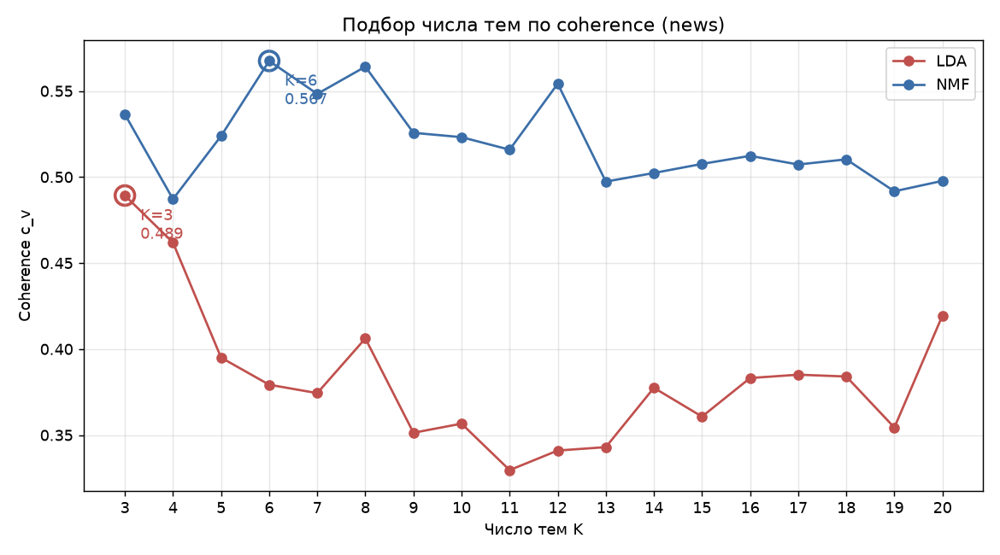

На графике видно, как меняется качество тем в зависимости от их количества. Синяя линия (NMF) везде выше красной (LDA): при любом числе тем NMF находит более понятные темы.

- У NMF лучший результат при **6 темах** (c_v = 0.567). Почти так же хорошо при 8 и 12 темах.
- У LDA лучший результат при **3 темах** (c_v = 0.489). Начиная с 5 тем качество падает и держится в районе 0.33–0.42.

Вывод: для новостей лучше подходит NMF с 6 темами.

#### Темы NMF

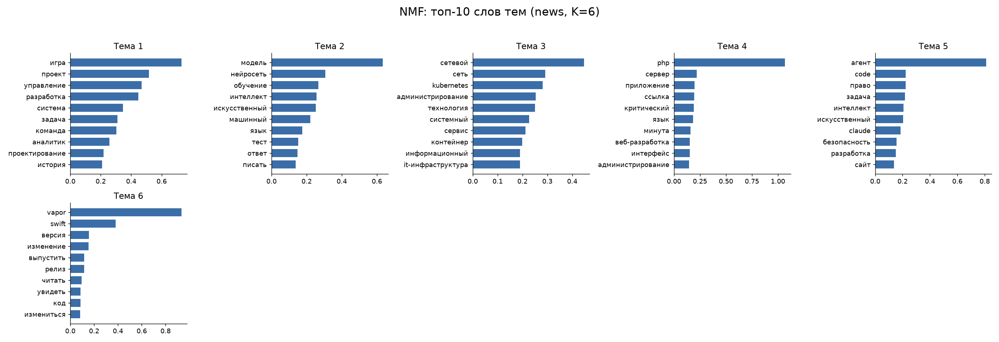

Каждый столбик - вес слова в теме: чем длиннее столбик, тем важнее слово. По словам темы легко назвать:

| Тема | Главные слова | Как я её назвал | Статей |
|---|---|---|---:|
| T1 | игра, проект, управление, разработка, команда, аналитик | разработка игр и управление проектами | 62 |
| T2 | модель, нейросеть, обучение, искусственный интеллект | нейросети и машинное обучение | 62 |
| T3 | сетевой, сеть, kubernetes, администрирование, контейнер | сети и серверная инфраструктура | 50 |
| T4 | php, сервер, критический, веб-разработка | веб-разработка и уязвимости PHP | 13 |
| T5 | агент, code, claude, безопасность | ИИ-агенты для программистов | 27 |
| T6 | vapor, swift, версия, релиз | выход новой версии фреймворка Vapor | 6 |

Тема T6 совсем маленькая: в ней почти только статьи про один фреймворк, зато она очень чёткая.

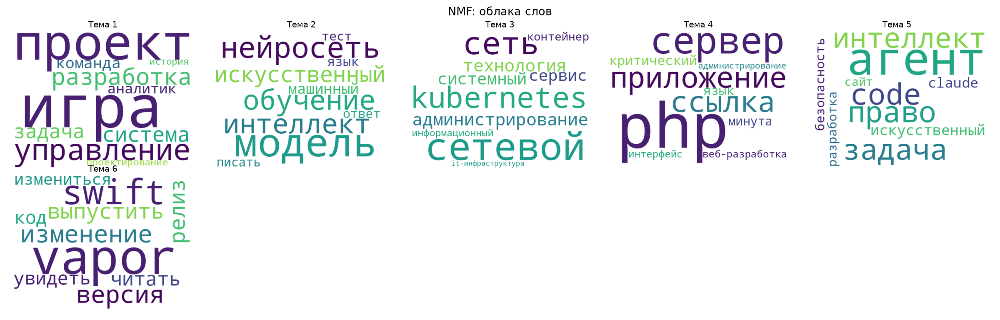

Облака слов показывают то же самое, только нагляднее: самое большое слово - самое важное в теме. По облакам темы угадываются с первого взгляда: «игра / проект», «модель / нейросеть», «сеть / kubernetes», «php / сервер», «агент / code», «vapor / swift».

#### Темы LDA

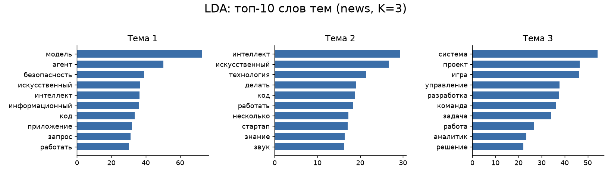

LDA выбрала всего 3 темы, и они слишком общие. В первых двух повторяются одни и те же слова «искусственный» и «интеллект», а в топ попали слова «делать», «работать», «несколько», которые ничего не говорят о теме. Понять, чем тема 1 отличается от темы 2, сложно.

#### Насколько темы большие

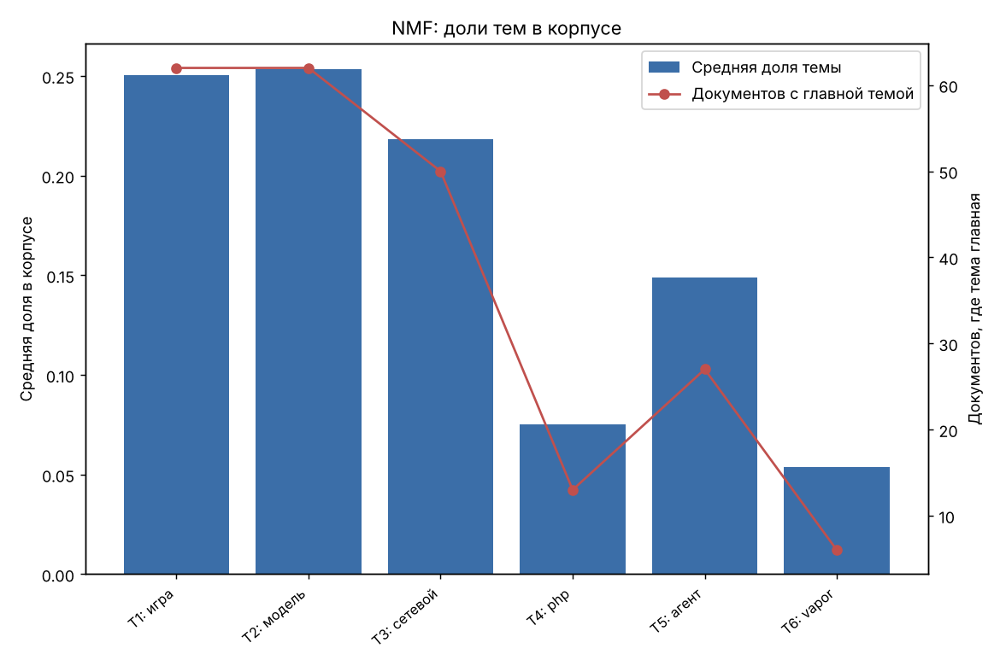

Синие столбики - средняя доля темы во всех статьях, красная линия - у скольких статей эта тема главная. Больше всего статей про игры/проекты и про нейросети (по 62), за ними сети и инфраструктура (50). Логичнно, т.к. в ленте Habr много статей про ИИ и разработку.

#### Из каких тем состоят статьи

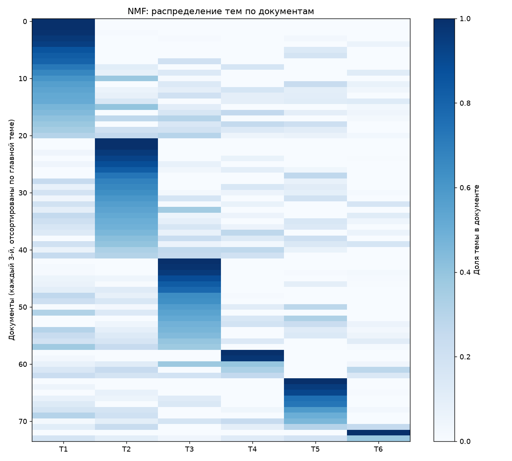

Каждая строка - статья, каждый столбец - тема. Чем темнее клетка, тем больше этой темы в статье. Статьи отсортированы по главной теме, поэтому получились тёмные блоки по диагонали. У многих статей есть ещё светлые клетки в соседних столбцах: статья про ИИ-агентов может немного касаться и нейросетей, и разработки. Это нормально: одна статья редко бывает строго про одно.

#### Похожесть тем

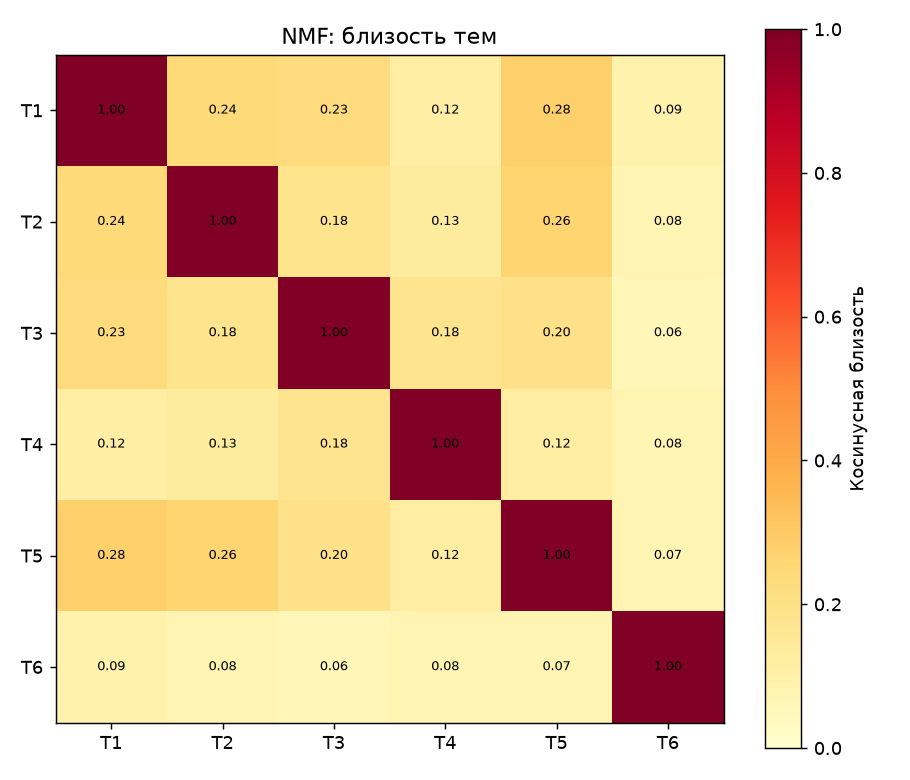

Чем темнее клетка, тем больше у двух тем общих слов. Все темы между собой похожи слабо (не больше 0.28), то есть разделились хорошо. Сильнее всего пересекаются T1, T2 и T5: игры и проекты, нейросети и ИИ-агенты, т.к. они все про разработку. Тема T6 про Swift почти ни на что не похожа.

---

### 7.2. Товары Wildberries (NMF, 15 тем)

Здесь я специально взял 15 тем, потому что товары собирались из 15 категорий. Чтобы проверить, найдёт ли модель эти категории сама, ничего о них не зная.

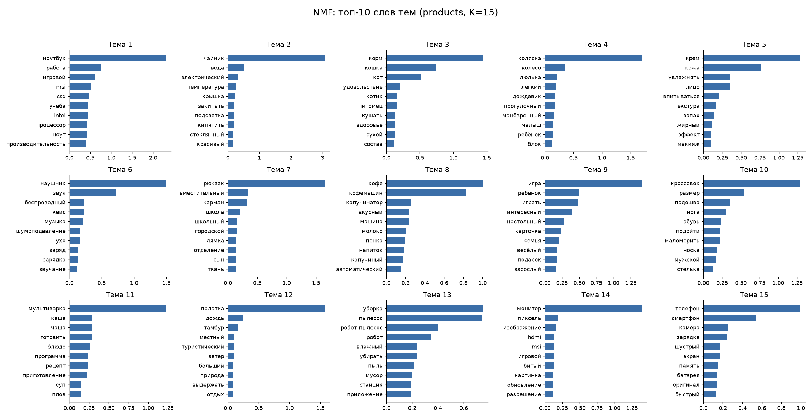

Каждая из 15 тем совпала ровно с одной категорией:

| Тема | Главные слова | Категория |
|---|---|---|
| T1 | ноутбук, работа, игровой, msi, ssd, учёба | ноутбуки |
| T2 | чайник, вода, температура, крышка, закипать | чайники |
| T3 | корм, кошка, кот, удовольствие, питомец | корм для кошек |
| T4 | коляска, колесо, люлька, лёгкий, дождевик | детские коляски |
| T5 | крем, кожа, увлажнять, лицо, впитываться | крем для лица |
| T6 | наушник, звук, беспроводный, кейс, шумоподавление | наушники |
| T7 | рюкзак, вместительный, карман, школа | рюкзаки |
| T8 | кофе, кофемашина, капучинатор, молоко, пенка | кофемашины |
| T9 | игра, ребёнок, играть, интересный, настольный | настольные игры |
| T10 | кроссовок, размер, подошва, нога, маломерить | кроссовки |
| T11 | мультиварка, каша, чаша, готовить, рецепт | мультиварки |
| T12 | палатка, дождь, тамбур, туристический | палатки |
| T13 | уборка, пылесос, робот, влажный, пыль | роботы-пылесосы |
| T14 | монитор, пиксель, изображение, hdmi, битый | мониторы |
| T15 | телефон, смартфон, камера, зарядка, батарея | смартфоны |

Средний coherence получился **0.924** - высокое значение. Причина простая - у товаров из разных категорий почти нет общих слов. Например, отзыв про корм и отзыв про монитор никак не пересекаются.

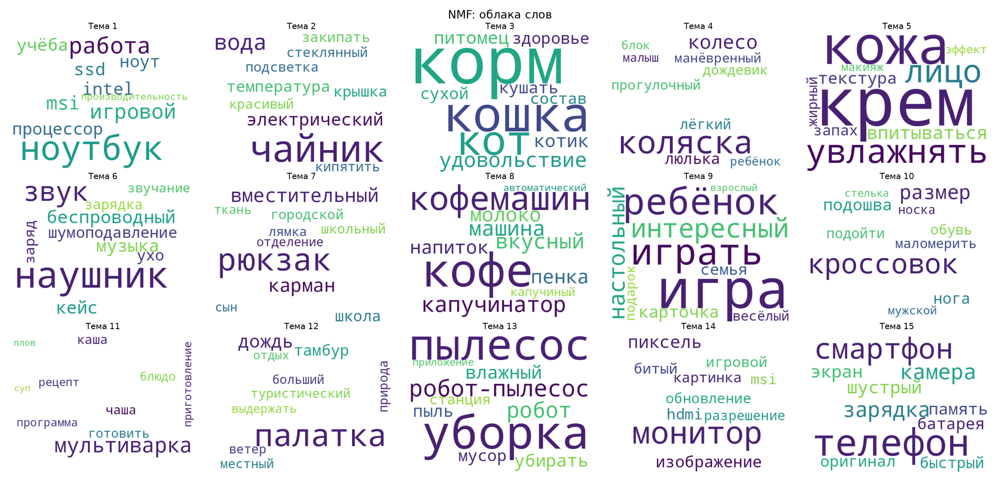

По облакам видно, что модель вытащила не только название товара, но и то, что о нём пишут покупатели:

- про кроссовки - «размер», «маломерить», «подошва» (люди жалуются, что маломерят);
- про корм - «удовольствие», «кушать», «здоровье» (кошки едят с удовольствием);
- про коляски - «манёвренный», «лёгкий», «дождевик»;
- про мониторы - «пиксель», «битый» (проверяют на битые пиксели);
- про крем - «увлажнять», «впитываться», «текстура».

То есть по темам можно понять, на что покупатели обращают внимание в каждой категории.

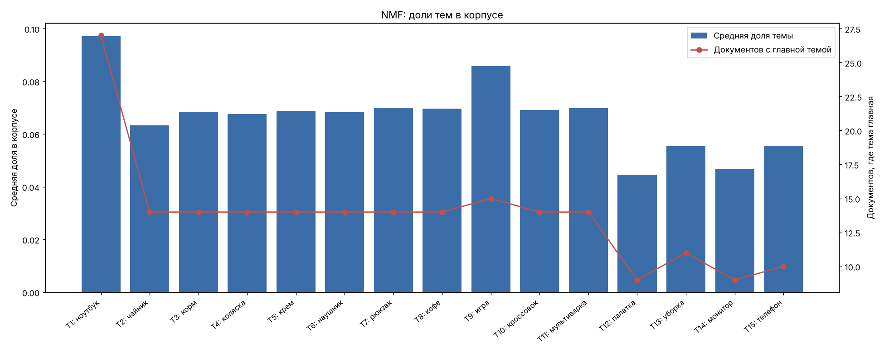

Почти все темы одного размера, по 14 товаров. Так и было при сборе: примерно по 14 товаров на категорию. Ноутбуков больше всего (27), потому что к ним добавились ноутбуки из ЛР4. Палаток, мониторов и смартфонов меньше: у части этих товаров не хватило отзывов.

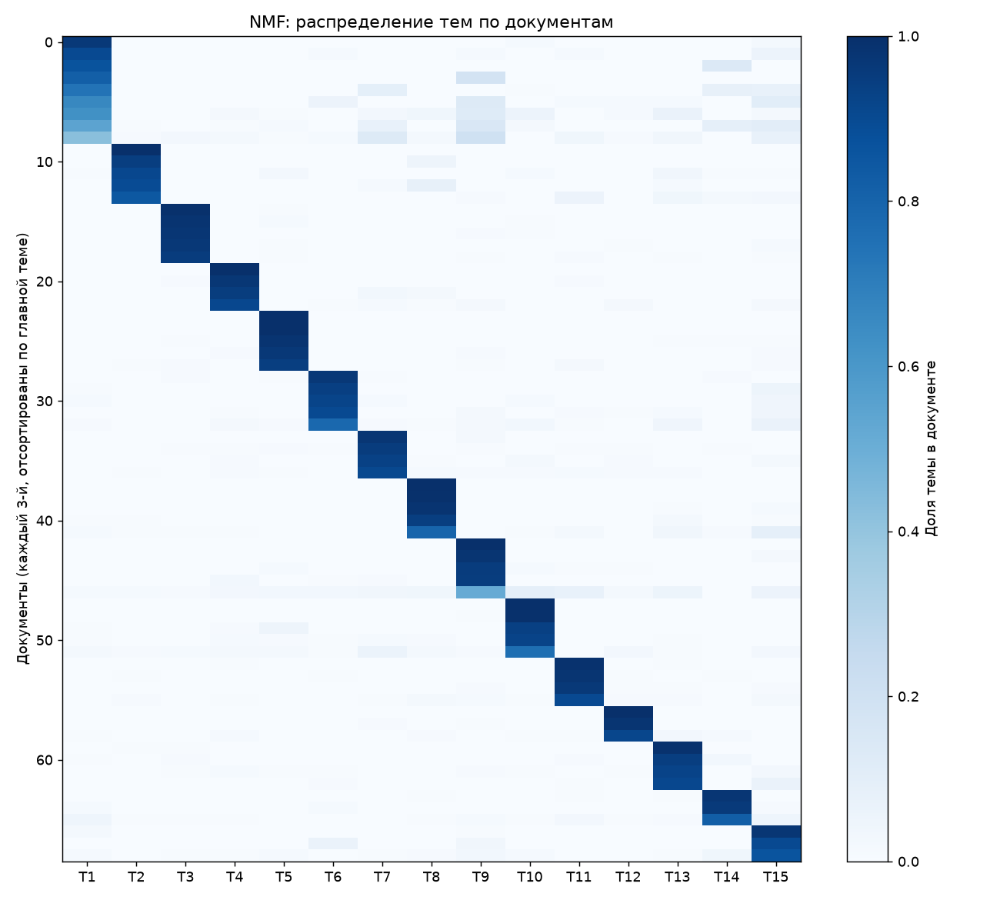

Получилась почти идеальная диагональ - у каждого товара одна тема занимает почти 100%, остальные почти пустые. Значит, что модель уверенно относит каждый товар к своей категории. Немного размыты только ноутбуки (T1) и настольные игры (T9): в отзывах про ноутбуки встречаются слова про игры и мониторы.

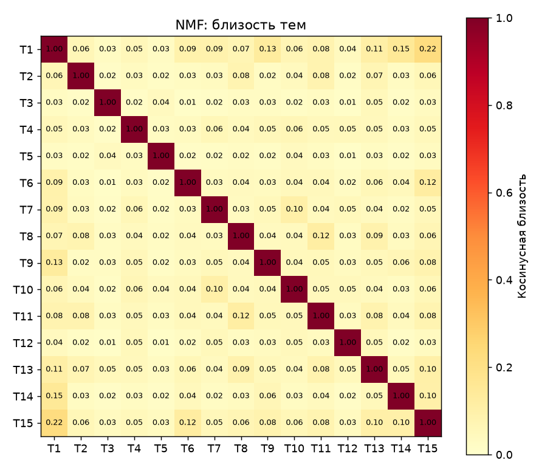

Почти все темы между собой похожи меньше чем на 0.1. Чуть заметнее связаны ноутбуки со смартфонами (0.22) и с мониторами (0.15): во всех трёх говорят про экран, зарядку и игры.

---

### 7.3. Сравнение LDA и NMF на всех данных сразу

Здесь я смешал новости и товары (427 документов) и запустил оба метода с 10 темами.

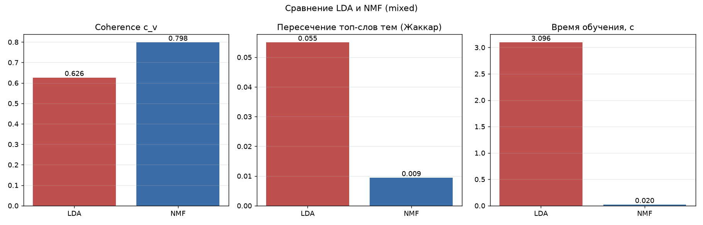

| Метод | Темы | Coherence | Пересечение тем | Время обучения |
|---|---:|---:|---:|---:|
| LDA | 10 | 0.626 | 0.055 | 3.1 с |
| NMF | 10 | **0.798** | **0.009** | **0.02 с** |

- **Coherence** у NMF заметно выше, то есть темы понятнее.
- **Пересечение тем** показывает, сколько общих слов у разных тем. У NMF оно в 6 раз меньше, темы лучше разделены.
- **Время**: NMF обучился примерно в 150 раз быстрее.

#### Темы NMF

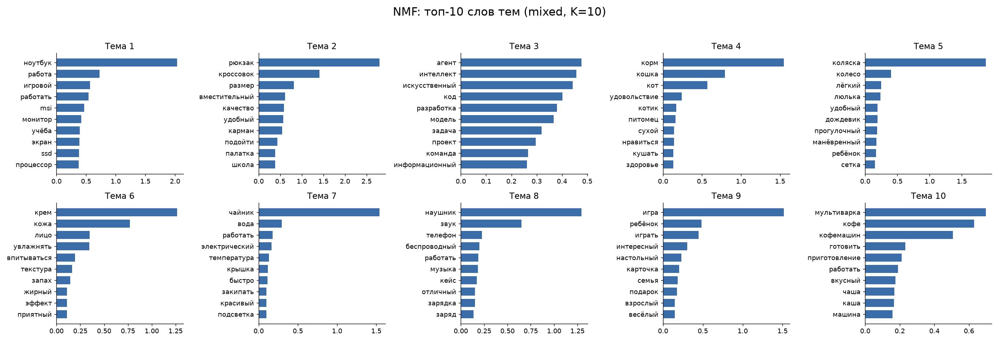

NMF сложил все статьи Habr в одну тему T3 (207 документов): на фоне чайников и кремов все IT-статьи для него одна тема. Остальные 9 тем - товары. Если тем меньше, чем категорий, NMF объединяет похожие: рюкзаки с кроссовками (T2, обе про размер и качество), мультиварки с кофемашинами (T10, обе про приготовление еды).

#### Темы LDA

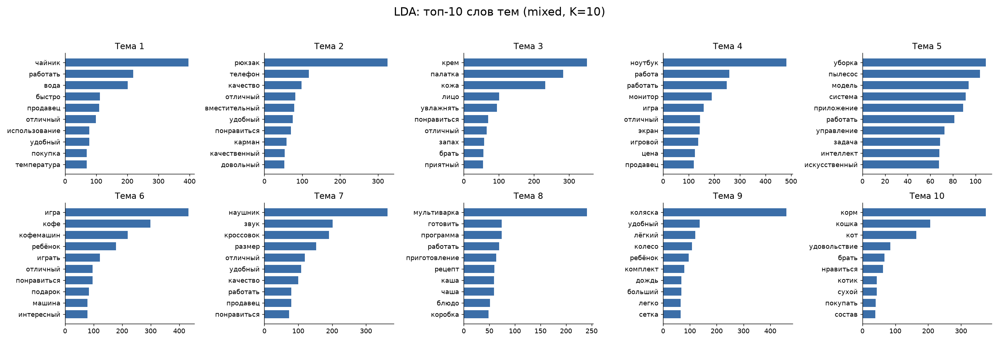

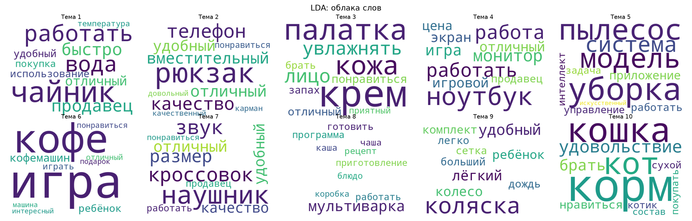

У LDA видны странные смеси:

- тема 3: **крем + палатка**;
- тема 6: **игра + кофе**;
- тема 7: **наушники + кроссовки**;
- тема 5: **статьи Habr + пылесос и уборка**.

В топ LDA попадает много общих слов из отзывов: «отличный», «удобный», «работать», «понравиться», «продавец». Они есть в любом отзыве и тему не описывают.

#### Распределение тем по документам

LDA:

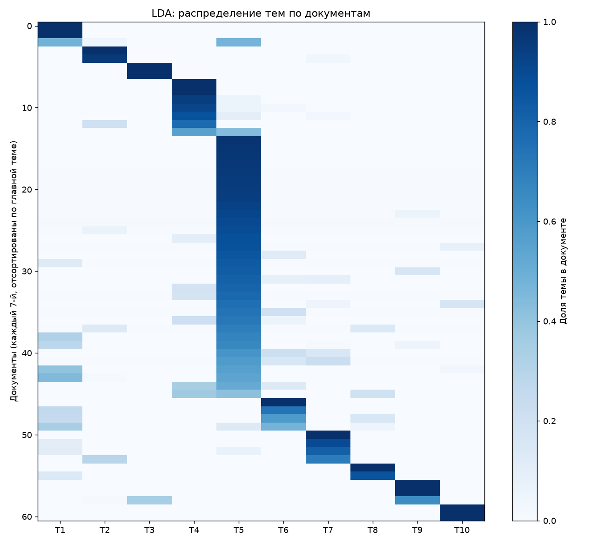

NMF:

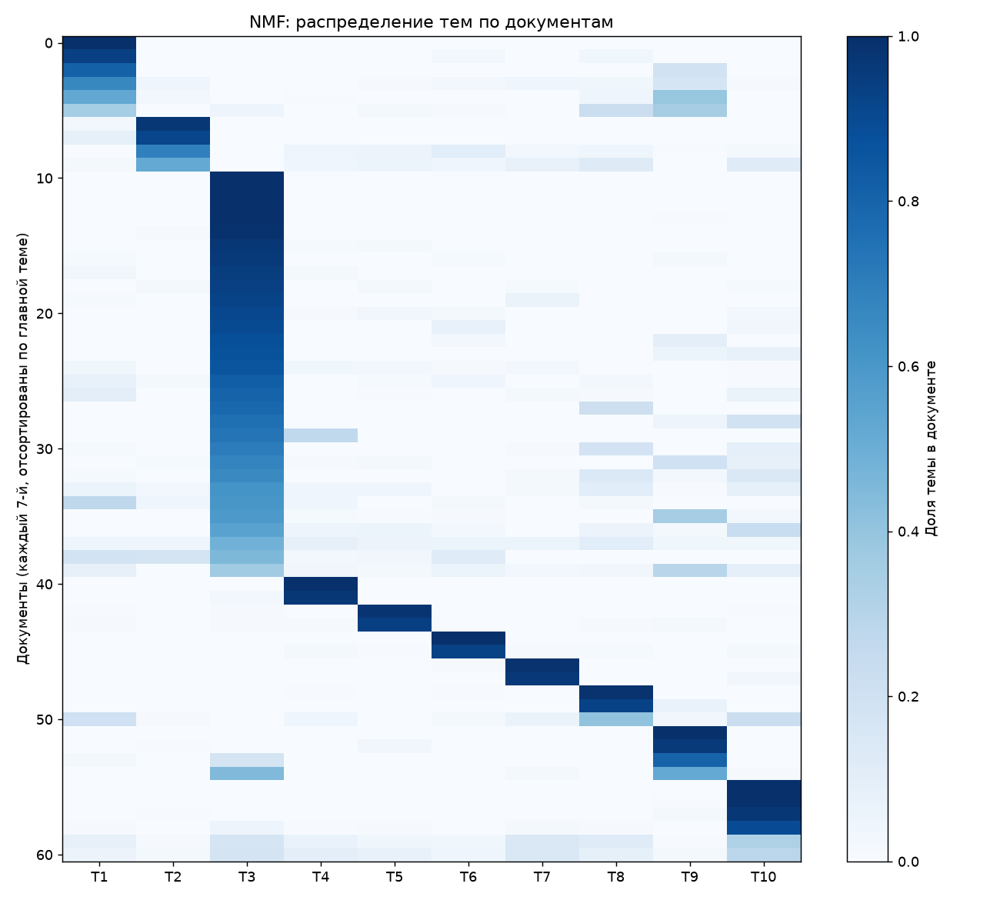

У обоих методов виден большой тёмный блок - это статьи Habr. У LDA в этот блок попал 221 документ, и в топ-словах этой темы стоят «уборка» и «пылесос», то есть к статьям прилипли роботы-пылесосы. У NMF в этом блоке 207 документов, а товары лежат в своих маленьких блоках.

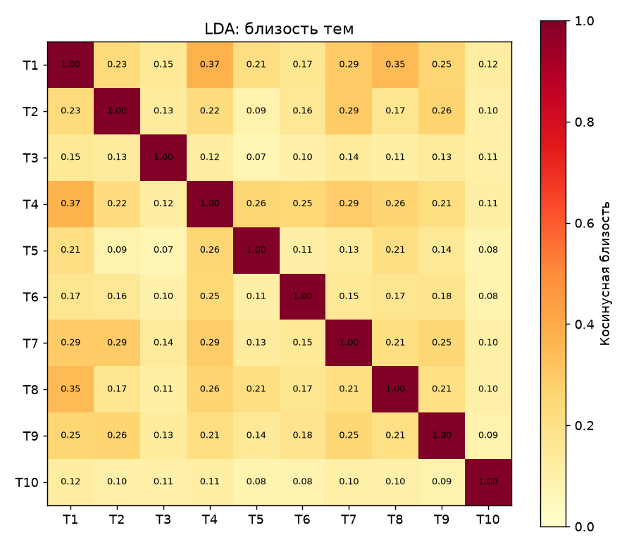

Темы LDA заметно похожи друг на друга: у многих пар близость 0.2–0.37. Это те самые общие слова из отзывов, которые попадают сразу в несколько тем.

**Итог:** на моих данных NMF лучше по всем пунктам: темы понятнее, меньше пересекаются, и считается всё быстрее. LDA больше подходит, когда нужна именно вероятность принадлежности документа к теме, но на коротких отзывах она смешивает разные категории.

---

### 7.4. Пример 2: кластеризация городов по блюдам

#### Как собирались данные

Для 9 городов (Пермь, Кунгур, Казань, Уфа, Москва, Санкт-Петербург, Новосибирск, Хабаровск, Петрозаводск) я искал в интернете «блюда <города>» и выписывал со страниц все упомянутые блюда. Всего 29 сайтов, по 2–4 на город. Все ссылки лежат в `data/dishes_raw.json`.

Одно и то же блюдо на разных сайтах пишут по-разному, поэтому названия я привёл к одному виду: «учпочмак» = «эчпочмак», «бишбармак» = «бешбармак», «тукмас» = «токмач». Если в названии два блюда («пельмени с лосятиной»), оно засчитывается и как пельмени, и как лосятина.

Каждый город превращается в вектор: для каждого блюда считается доля сайтов про этот город, где блюдо упомянуто. 0 - ни разу, 1 - на всех сайтах. Блюда, которые есть больше чем в 60% городов (**пельмени, пироги, чай**), я убрал: они есть везде и города не различают. Осталось 186 блюд.

#### Сколько кластеров брать

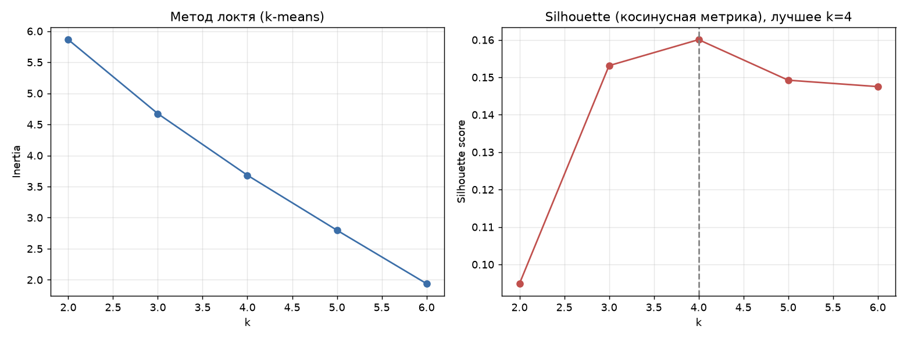

Слева метод локтя: инерция плавно падает, явного излома нет. Справа silhouette (насколько города внутри кластера ближе друг к другу, чем к чужим). Лучшее значение при **k = 4**.

#### Результат

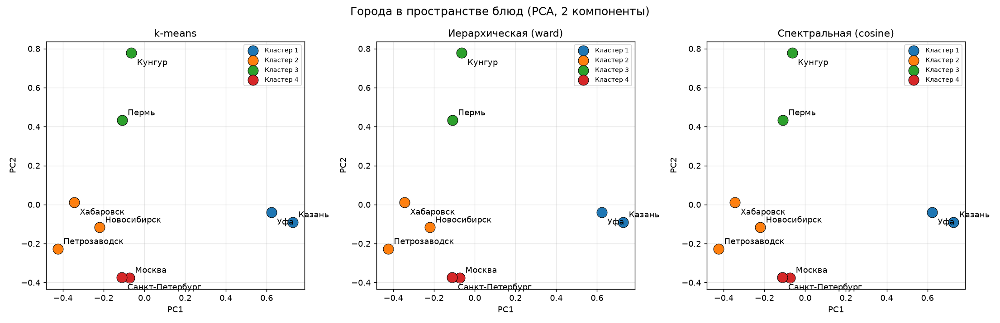

Здесь 186 блюд сжаты до двух осей, чтобы города можно было нарисовать на плоскости. Цвет - номер кластера. Все три метода (k-means, иерархическая и спектральная кластеризация) дали одинаковый результат:

| Кластер | Города | Что общего |
|---|---|---|
| 1 | Казань, Уфа | татарская и башкирская кухня: бешбармак, эчпочмак, чак-чак, токмач, конина |
| 2 | Новосибирск, Хабаровск, Петрозаводск | северная и сибирская кухня: оленина, лосятина, медвежатина, брусника, морошка, грибы, икра |
| 3 | Пермь, Кунгур | пермская кухня: посикунчики, вязовские пряники, сур, черинянь |
| 4 | Москва, Санкт-Петербург | столичная кухня: блины, торты, пирожные, уха, пышки, корюшка |

Получилось логично: города с общей кулинарной традицией оказались вместе.

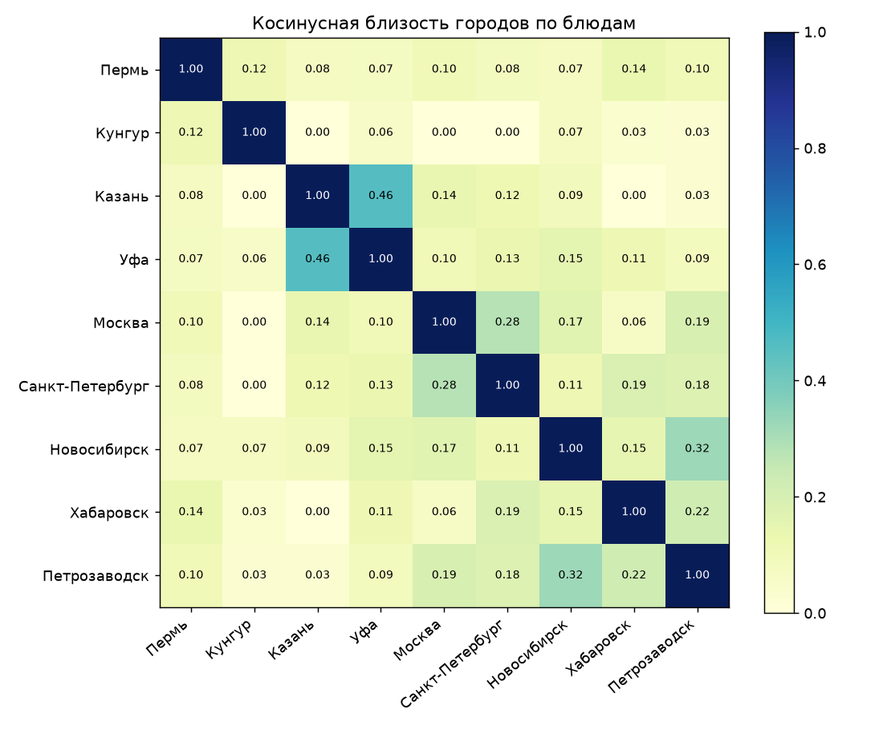

Таблица показывает, насколько похожи меню городов. Самая сильная пара - **Казань и Уфа (0.46)**, у них почти одинаковые национальные блюда. Дальше идут Новосибирск и Петрозаводск (0.32) и Москва с Петербургом (0.28). Кунгур почти ни на кого не похож: про него в интернете пишут в основном про пряники.

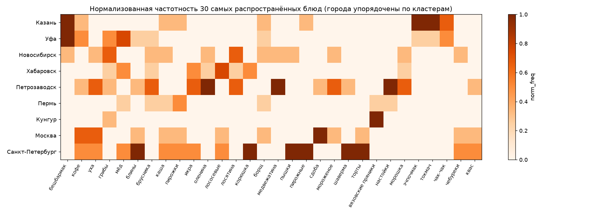

Здесь видно, какие блюда отличают каждый кластер. У Казани и Уфы тёмные клетки на бешбармаке, эчпочмаке и чак-чаке. У Петрозаводска - на медвежатине, оленине и морошке. У Петербурга - на корюшке и пышках. У Кунгура - на вязовских пряниках.

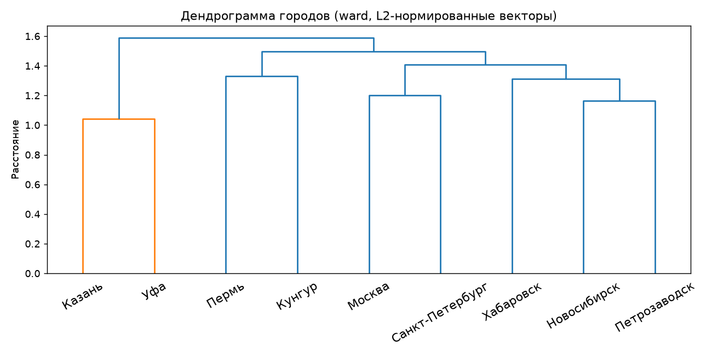

Дендрограмма показывает, в каком порядке города объединяются: чем ниже точка соединения, тем города ближе. Раньше всех объединяются Казань и Уфа, а к остальным городам они присоединяются только в самом конце, настолько их кухня отличается. Новосибирск, Петрозаводск и Хабаровск собираются в одну группу, к ним подходят Москва с Петербургом, а Пермь и Кунгур стоят отдельной парой.

Silhouette получился невысоким (0.16), потому что сайтов на город мало, а редких блюд, которые упоминаются только у одного города, много. Но по смыслу кластеры правильные, и все три метода сошлись на одном и том же разбиении.

---

## 8. Соответствие заданию

| Что требовалось | Где сделано |
|---|---|
| Предобработка и векторизация | `text_preprocessing.py`, CountVectorizer / TfidfVectorizer |
| Методы LDA и NMF | `topic_modeling.py` |
| Оценка качества (coherence) | c_v для каждой темы и в среднем |
| Подбор числа тем по coherence с графиком | `--topics auto`, `news_topics_coherence.png` |
| Визуализация тем | топ-слова, облака слов, доли тем, тепловые карты |
| Темы по документам | `*_doc_topics.csv` |
| Ключевые слова тем с весами | `*_topics.json` |
| Облака слов | `*_wordclouds.png` |
| CLI с `--dataset --method --topics --output --compare` | `topic_modeling.py` |
| 2 набора данных по 200+ документов | 220 статей Habr, 207 товаров WB с отзывами |
| Пример 1: `plot_top_words`, LDA на счётчиках, NMF на TF-IDF | `plot_top_words()` в `topic_modeling.py` |
| Пример 2: кластеризация городов | `cities_clustering.py` |

---

## 9. Вывод

Я собрал два набора данных (220 статей Habr и 207 товаров Wildberries с отзывами) и написал скрипт, который сам находит в них темы.

На товарах получился самый наглядный результат: NMF без всякой разметки разложил 207 товаров ровно на те 15 категорий, по которым они собирались, и для каждой показал, что важно покупателям. Например, у кроссовок - размер, у кошачьего корма - что кошки его едят, у мониторов - битые пиксели.

На новостях темы сложнее, потому что статьи часто касаются сразу нескольких областей. Но NMF всё равно нашёл 6 понятных рубрик: нейросети, ИИ-агенты, инфраструктура, разработка игр и проекты, PHP и Swift.

При сравнении методов NMF оказался лучше LDA на всех данных: темы понятнее (coherence 0.80 против 0.63), меньше пересекаются, и обучение идёт в сотни раз быстрее. LDA часто смешивает в одну тему несвязанные вещи, например крем и палатку.

Кластеризация городов по блюдам дала 4 группы, которые совпадают с реальными кухнями: татаро-башкирская, пермская, столичная и северо-сибирская. Все три метода кластеризации дали одинаковый ответ.
