# Лабораторная работа №6 - автоматический анализ и семантическая обработка видео

## 1. Цель работы

Сделать систему, которая сама разбирает видео: что показывают в кадре, что говорят, где важные моменты, и позволяет найти нужный момент по запросу.

Я скачал 10 обзоров дистрибутивов Linux, разобрал их на кадры, звук и метаданные, нашёл объекты (YOLO), типы сцен (CLIP) и речь (Whisper), выделил события с временными метками, сгруппировал ролики по темам и сделал веб-интерфейс для поиска.

**Технологии:** Python, yt-dlp, ffmpeg, OpenCV, YOLO26 (ultralytics), CLIP (transformers), Whisper, scikit-learn, pymorphy3, matplotlib, Gradio.

---

## 2. Видео

По одному русскоязычному обзору на дистрибутив, 9-20 минут. Дистрибутивы выбирал разные: для новичков, для продвинутых, игровые, отечественные и для безопасности.

| Дистрибутив | Ролик | Канал |
|---|---|---|
| Ubuntu | [Windows все? Ubuntu 26.04 - ОС, которую мы ждали 10 лет!](https://www.youtube.com/watch?v=LApsH9CJH9U) | Sudoflops |
| Linux Mint | [Обзор Linux Mint 22.3 Cinnamon - Лучший и простой](https://www.youtube.com/watch?v=xL91zG0Sy4o) | DimBro |
| Debian | [Самый СТАБИЛЬНЫЙ И СТАРЫЙ Linux DEBIAN](https://www.youtube.com/watch?v=2p-4dcCgahY) | IT Positiv |
| Fedora | [FEDORA LINUX: Большой обзор и установка](https://www.youtube.com/watch?v=3KSRIBNjvjw) | StarsLinux |
| Arch Linux | [Мой опыт с ARCH LINUX](https://www.youtube.com/watch?v=F5r1Av5o7r4) | ZProger [ IT ] |
| Kali Linux | [Kali Linux - для чего он?](https://www.youtube.com/watch?v=KRWYagopA28) | Dikamen |
| Astra Linux | [Обзор Астра Линукс 2024. Обучение для чайников](https://www.youtube.com/watch?v=zh2aS5ORfH4) | IT-спец. Денис Курец |
| РЕД ОС | [Что там с российскими Linux дистрибутивами? Обзор Red OS](https://www.youtube.com/watch?v=DZXzBtnuyLo) | Andrew Tech Tips |
| CachyOS | [CachyOS: Оптимизированный Arch для всех!](https://www.youtube.com/watch?v=78q4EFM-QlM) | Werstey |
| Bazzite | [Я попробовал лучший дистрибутив для геймера - Bazzite Linux](https://www.youtube.com/watch?v=0_qCMtHT_IA) | pluseight |

---

## 3. Структура и запуск

`pipeline.py` скачивает ролики из `videos.csv` и прогоняет их через все этапы, `topics.py` группирует по темам, `report.py` строит графики и шкалу событий, `app.py` запускает интерфейс. Пороги лежат в `common.py`, словарь дистрибутивов и программ - в `entities.py`.

Результаты по каждому ролику сохраняются в `data/<id>/`, графики и таблицы - в `results/`. Готовые этапы при повторном запуске пропускаются, поэтому YOLO и Whisper заново не гоняются. Если ролик или этап пропущен, причина пишется в `data/skipped.json`.

```powershell
winget install Gyan.FFmpeg
winget install DenoLand.Deno
python -m venv .venv
.\.venv\Scripts\Activate.ps1
pip install torch torchvision --index-url https://download.pytorch.org/whl/cu128
pip install -r requirements.txt

.\run.ps1          # всё сразу, лог в results\run_log.txt
python .\app.py    # интерфейс
```

---

## 4. Как это работает

**Метаданные.** yt-dlp скачивает видео в 720p и сохраняет название, канал, просмотры, лайки, комментарии, теги и главы. ffprobe даёт кодек, разрешение, fps и битрейт. Вовлечённость считаю как (лайки + комментарии) / просмотры.

**Кадры.** Одинаковая частота для всех роликов не подходит: в скринкасте картинка минутами не меняется, а в игре меняется постоянно. Поэтому 4 раза в секунду сравниваю кадр с последним сохранённым по цветовым гистограммам. Если картинка заметно изменилась, сохраняю кадр (не чаще 2 раз в секунду), а если нет - раз в 2 секунды.

**Объекты.** YOLO26s, самая новая модель Ultralytics, ищет на кадрах объекты 80 классов COCO. YOLO12 не взял, её Ultralytics не советует для практического использования. Сохраняю всё от уверенности 0.25, а в статистику беру от 0.5, чтобы порог можно было менять без перезапуска.

**Тип сцены.** YOLO не понимает, что на экране, поэтому дополнительно использую CLIP. Он сравнивает кадр с текстовыми описаниями и выбирает подходящий тип: терминал, рабочий стол, установщик ОС, настройки, браузер, человек в кадре, игра, заставка. Если уверенность ниже 0.4, ставлю «другое».

**Звук и речь.** Громкость считаю по окнам 0,5 с. Пик - громче медианы ролика на 3 MAD, тишина - тише -45 dBFS дольше 2 с. Whisper (`small`) переводит речь в текст с временными метками.

**События.** Каждое событие - интервал «с ... по ...»: смена сцены, тип сцены (дольше 4 с), объект (минимум 2 кадра), пик громкости, тишина, упоминание дистрибутива или программы, глава ролика. Whisper пишет названия то латиницей, то кириллицей («KDE» и «кеды»), поэтому в `entities.py` для каждого названия несколько вариантов.

**Темы.** Для ролика собираю один документ: название, описание, теги, транскрипт и «визуальные слова» (типы сцен и объекты). Группирую через KMeans (число кластеров по silhouette) и NMF (число тем по coherence).

**Интерфейс.** В `app.py` можно ввести слово, объект, тип сцены или дистрибутив, например «драйвер nvidia». Клик по найденной строке открывает плеер YouTube с этой секунды, рядом карточка ролика и шкала событий, где каждый блок тоже ведёт на свой момент. Шкала всех роликов сразу сохраняется в `results/timeline.html`.

---

## 5. Результаты

Все 10 роликов обработались без пропусков. Это 143 минуты видео, 6084 кадра, почти 18 тысяч слов и 2579 событий.

### 5.1. Метаданные

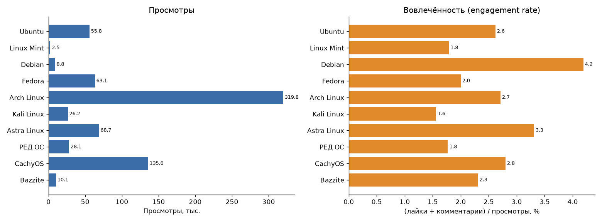

Больше всего просмотров у Arch Linux (320 тыс.) и CachyOS (136 тыс.), меньше всего у Linux Mint (2,5 тыс.). Вовлечённость с просмотрами почти не связана: больше всего у Debian (4,2%) при 8,8 тыс. просмотров, у небольшого канала аудитория активнее. Меньше всего у Kali (1,6%).

### 5.2. Что показывают в кадре

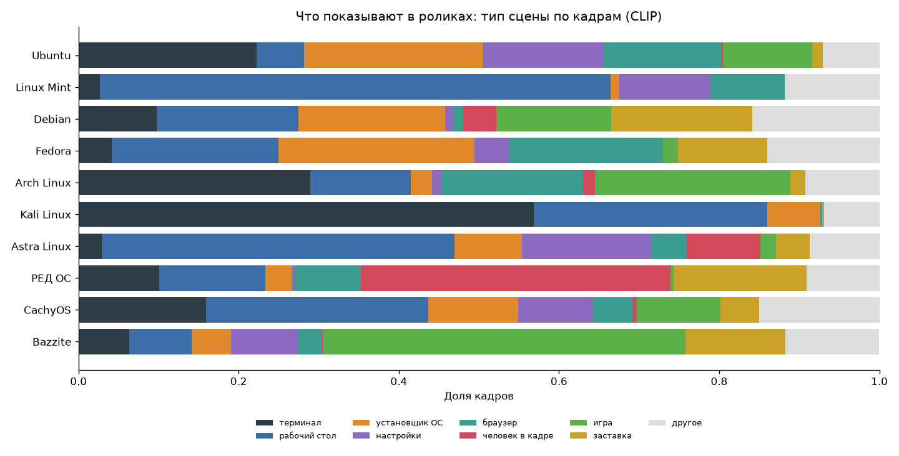

По типам сцен хорошо видно характер роликов: в Kali больше половины кадров терминал, в Bazzite почти половина игра, в РЕД ОС больше трети автор в кадре, Linux Mint и Astra - в основном рабочий стол, а в Ubuntu, Fedora и Debian заметная доля установщика. Серым отмечены кадры, где CLIP не уверен (7-16%).

### 5.3. Объекты

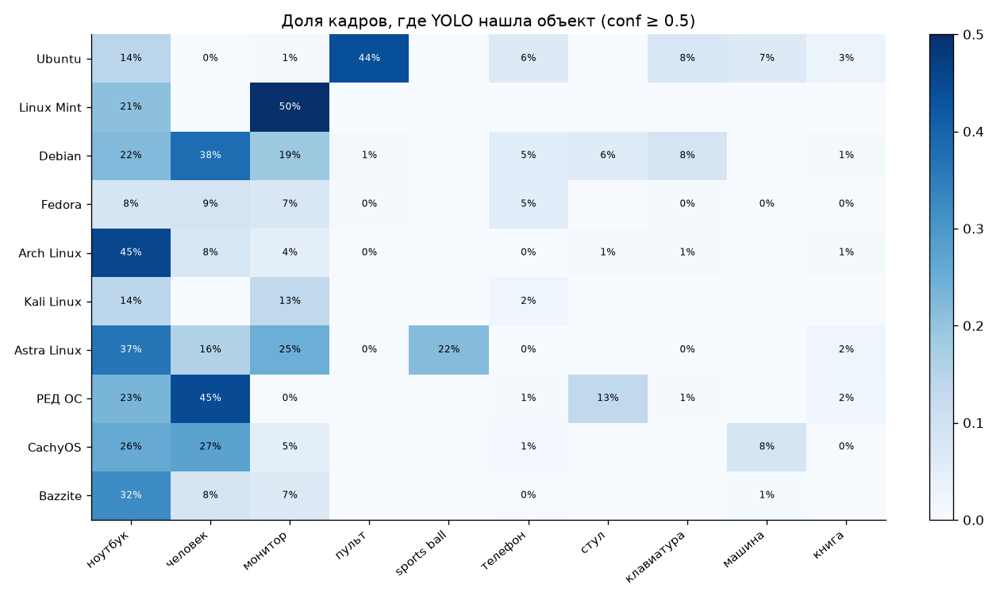

YOLO обучена на фотографиях, а большая часть кадров - скриншоты. Поэтому окна программ она принимает за ноутбук или монитор, а сетку иконок в Ubuntu - за пульт (44% кадров). На живой съёмке работает нормально: в РЕД ОС и Debian правильно находит автора, стул, ноутбук и клавиатуру. Для скринкастов YOLO полезна только для поиска людей и настоящих устройств, понимать экран лучше получается у CLIP.

### 5.4. Речь и упоминания

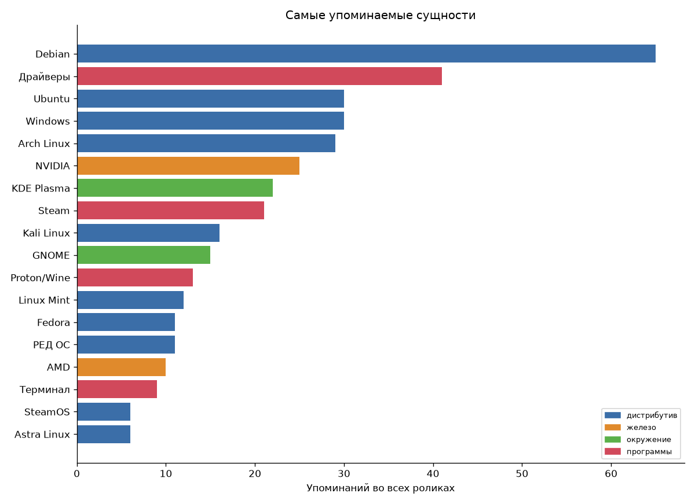

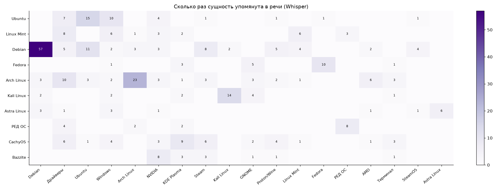

Чаще всего упоминается Debian (65 раз): кроме своего ролика, о нём говорят как об основе Kali, Astra и Ubuntu. На втором месте драйверы (41), это главная боль при переходе на Linux. Windows упоминают так же часто, как Ubuntu (30 раз), почти все сравнивают с ней. В игровых роликах звучат Steam, Proton и NVIDIA, в Arch - драйверы, AMD и AUR.

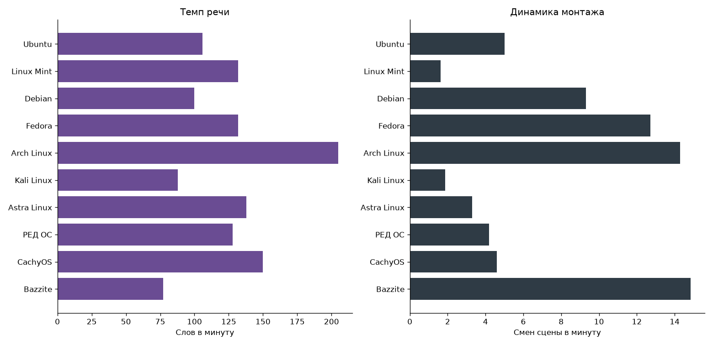

Быстрее всех говорит автор про Arch (205 слов в минуту), медленнее всего - про Bazzite (77), там много игры без комментариев. Самый динамичный монтаж в Bazzite, Arch и Fedora (13-15 смен сцены в минуту), а Mint и Kali сняты почти одним дублем. Адаптивная выборка это учла: с Mint взято 30 кадров в минуту, с Bazzite 62.

### 5.5. Шкала событий

**Arch Linux:**

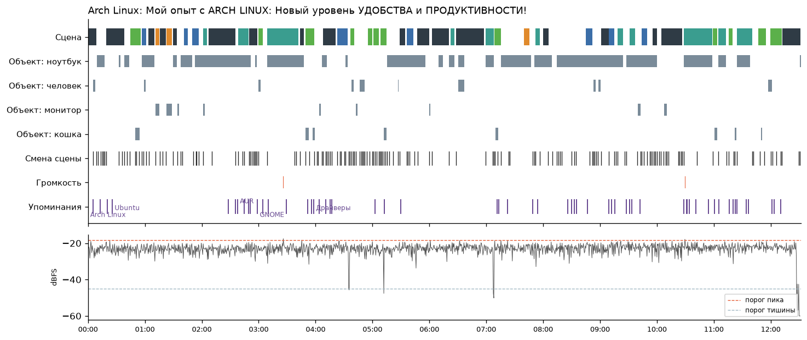

Сцены постоянно меняются между терминалом, браузером и игрой. Громкость ровная, автор говорит без пауз, упоминания идут по всему ролику.

**Bazzite:**

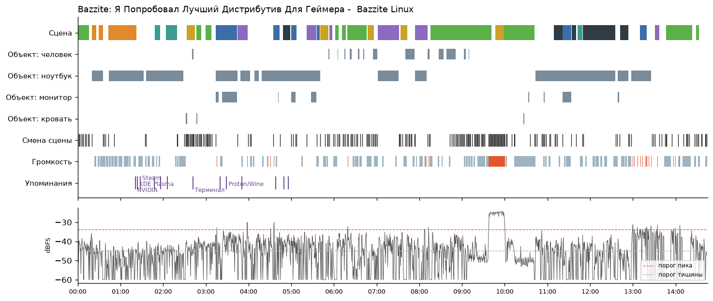

Длинные куски игры, а около 09:30 громкий игровой фрагмент. Упоминания программ только в первых 5 минутах, дальше игры. Здесь же видна ошибка: тишиной отмечено больше половины ролика, потому что автор говорит тихо (около -45 dBFS). Тишину правильнее считать относительно громкости каждого ролика, а не одним порогом для всех.

### 5.6. Темы

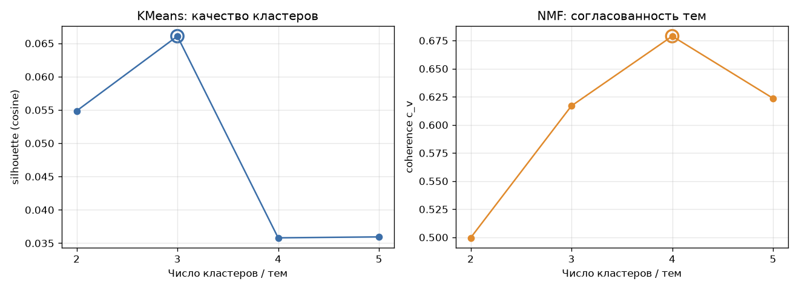

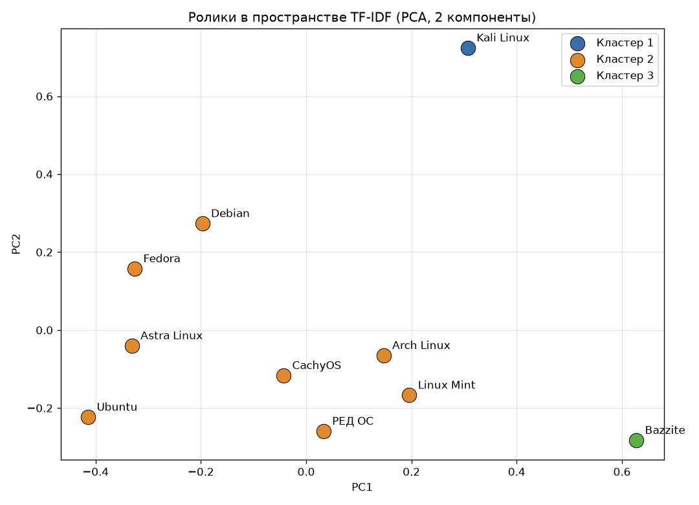

KMeans лучше всего при 3 кластерах, но silhouette всего 0,066: он отделил только Kali и Bazzite, остальные 8 обзоров про установку и настройку оказались вместе.

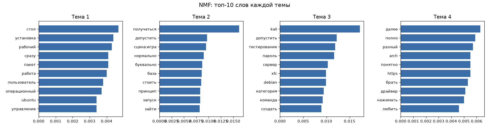

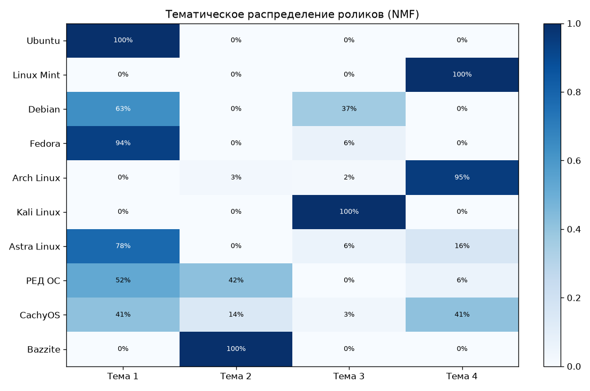

NMF лучше всего при 4 темах (coherence 0,679), и разбиение интереснее:

| Тема | Главные слова | Ролики | Название |
|---|---|---|---|
| 1 | стол, установка, рабочий, пакет | Ubuntu, Fedora, Astra, Debian, РЕД ОС | установка и обзор |
| 2 | сцена:игра, запуск, база | Bazzite, часть РЕД ОС и CachyOS | игры |
| 3 | kali, тестирование, пароль, сервер | Kali, треть Debian | безопасность и серверы |
| 4 | arch, драйвер, разный | Arch, Mint, половина CachyOS | опыт использования |

CachyOS наполовину попал в тему Arch, и он как раз основан на Arch. Визуальное слово «сцена:игра» само попало в топ игровой темы, значит, кадры тоже помогают группировке. Разговорных слов («получаться», «буквально») в темах много, на 10 роликах от них не избавиться.

### 5.7. Выбор порогов

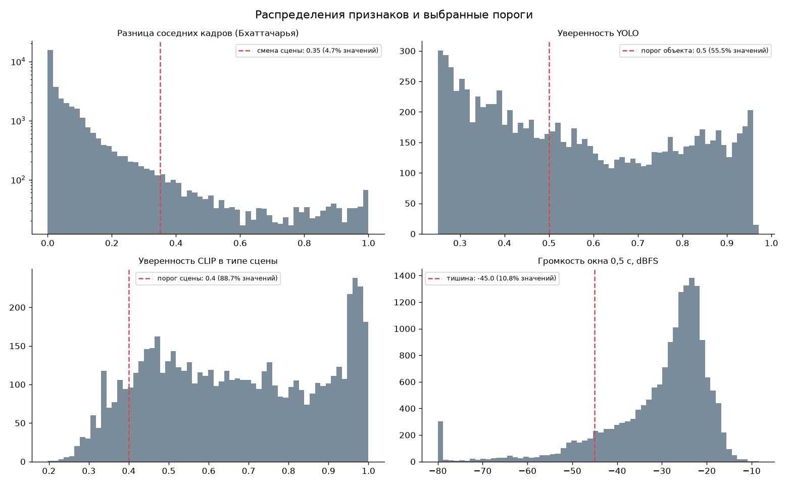

- **Смена сцены 0,35** - стоит за основной массой соседних кадров (это один и тот же экран), склейкой считается 4,7% сравнений.
- **YOLO 0,5** - распределение двугорбое, порог отрезает горб слабых срабатываний 0,25-0,4, которые по выборке почти всегда ошибки.
- **CLIP 0,4** - ниже модель почти угадывает между 8 вариантами, это 11% кадров.
- **Тишина -45 dBFS** - речь идёт на уровне -35...-20 dBFS, порог подходит всем роликам, кроме тихого Bazzite.

### 5.8. Ручная проверка

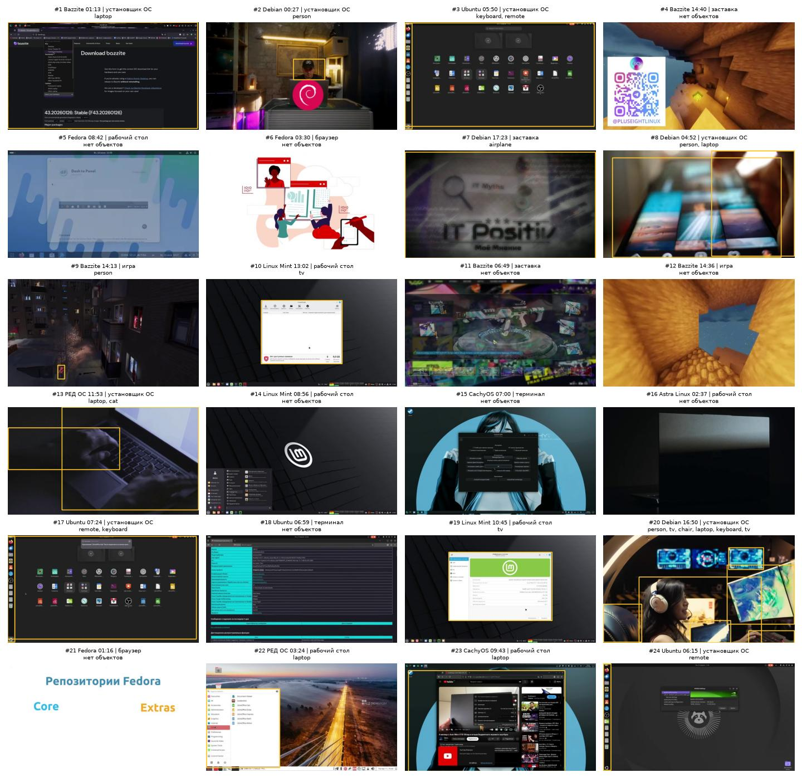

Я просмотрел 24 случайных кадра и 15 фрагментов речи (таблицы со ссылками на моменты в `results/verification/`).

- **YOLO:** правильных рамок 10 из 23 (около 45%). Люди и настоящие устройства находятся верно, ошибки почти все на скриншотах: окна как ноутбук (кадры 1, 10, 22, 23), иконки как пульт (3, 17, 24), руки как кошка (13).
- **CLIP:** точно угадано 8 кадров из 24 и ещё 3 близко, около 40%. Чаще всего ошибочно ставит «установщик ОС» окнам с кнопками и даже живой съёмке.
- **Whisper:** 12 фрагментов из 15 без ошибок. Ошибается в названиях («Фидор» вместо Fedora, «СС-h» вместо SSH), обычная речь распознаётся хорошо.

---

## 6. Вывод

Я сделал систему, которая разбирает видео на кадры, звук и метаданные, находит объекты, сцены, речь и события, группирует ролики по темам и позволяет найти нужный момент по запросу.

Лучше всего сработала речь: Whisper почти без ошибок даёт текст, и по нему видно, о чём ролик. С картинкой сложнее: YOLO на скриншотах путает окна с ноутбуками (около 45% верных рамок), CLIP лучше понимает экран и хорошо показывает характер ролика, но тоже ошибается (около 40%). Для таких роликов нужна модель, обученная на скриншотах. Группировка на 10 роликах слабая по метрикам, но осмысленная: отдельно выделились безопасность, игры и опыт с Arch.
