## 8. Результаты и анализ

Все 10 роликов обработались без пропусков, пустых транскриптов нет. Всего это 143 минуты видео, 6084 кадра, почти 18 тысяч слов речи и 2579 событий с временными метками.

Лог последнего запуска лежит в `results/run_log.txt`, все таблицы и графики - в `results/`.

### 8.1. Метаданные и вовлечённость

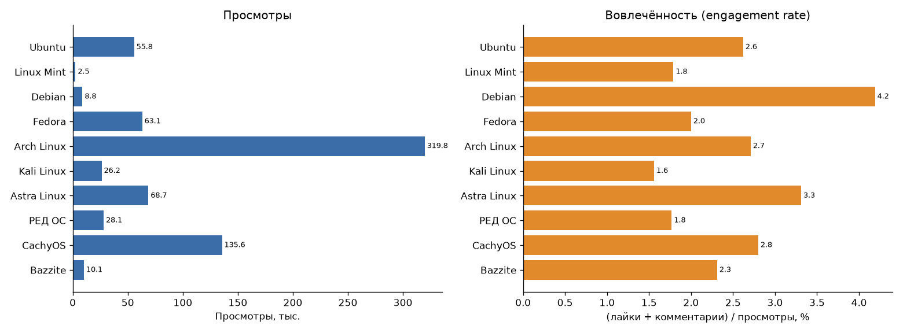

Все ролики скачались в 720p, у половины видеокодек AV1, у остальных H.264. Длина от 9 до 20 минут.

По просмотрам сильно выделяется Arch Linux (320 тыс.), дальше CachyOS (136 тыс.). Это популярные каналы, и тема «я перешёл на Arch» хорошо заходит. Самый маленький ролик - Linux Mint, всего 2,5 тыс. просмотров.

Вовлечённость считал как (лайки + комментарии) / просмотры. Она почти не связана с просмотрами: больше всего у Debian (4,2%) при всего 8,8 тыс. просмотров. Похоже, у небольшого канала аудитория активнее пишет комментарии и ставит лайки. Меньше всего у Kali Linux (1,6%).

### 8.2. Что показывают в кадре

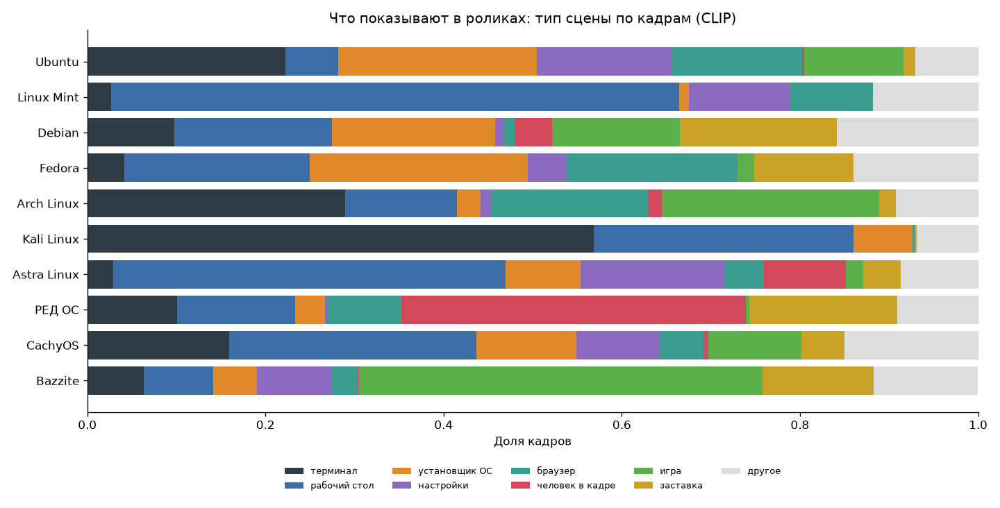

Это доля кадров каждого типа сцены по оценке CLIP. По графику хорошо видно, чем ролики отличаются:

- **Kali Linux** - больше половины кадров терминал, это понятно: дистрибутив для пентеста, всё делается командами;
- **Bazzite** - почти половина кадров игра, это игровой дистрибутив;
- **РЕД ОС** - больше трети кадров автор сидит в кадре и рассказывает;
- **Linux Mint** и **Astra Linux** - в основном рабочий стол, это спокойные обзоры интерфейса;
- **Ubuntu**, **Fedora** и **Debian** - заметная доля установщика, в них показывают установку системы.

Серым отмечены кадры, где уверенность CLIP ниже 0,4. Таких от 7 до 16% в разных роликах.

### 8.3. Объекты (YOLO)

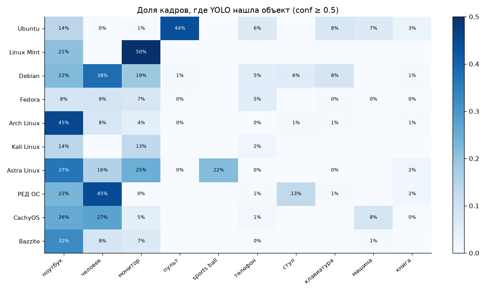

Здесь видно главное ограничение YOLO для таких роликов. Модель обучена на фотографиях реальных предметов, а большая часть кадров - это скриншоты экрана. Поэтому:

- окно программы на скриншоте YOLO часто принимает за ноутбук или монитор. Отсюда «ноутбук» почти во всех роликах и «монитор» на 50% кадров Linux Mint;
- сетку иконок приложений в Ubuntu YOLO видит как пульт и клавиатуру, поэтому у Ubuntu «пульт» на 44% кадров;
- в Astra Linux «мяч» на 22% кадров - это, скорее всего, круглые элементы интерфейса или обоев.

Там, где в кадре настоящая съёмка, YOLO работает нормально: в РЕД ОС и Debian правильно находит человека (автора), стул, ноутбук и клавиатуру.

Вывод: для анализа скринкастов YOLO полезна только для поиска людей и настоящих устройств в кадре. Понимать, что происходит на экране, лучше получается у CLIP.

### 8.4. Речь и упоминания

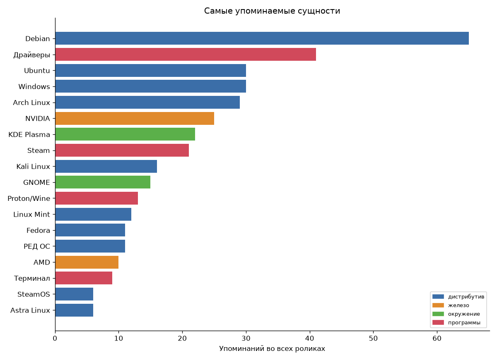

Чаще всего упоминается Debian (65 раз). 57 из них в самом ролике про Debian, а остальные в других роликах: на Debian основаны Kali, Astra и Ubuntu, и авторы об этом говорят.

На втором месте драйверы (41 раз). Про драйверы говорят почти во всех роликах, и это понятно, это главная боль при переходе на Linux. Рядом NVIDIA (25 раз).

Windows упоминается 30 раз, так же часто, как Ubuntu. Почти каждый автор сравнивает Linux с Windows.

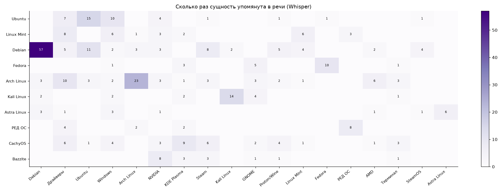

По тепловой карте видно, о чём говорят в каждом ролике. В играх (Bazzite, CachyOS) часто звучат Steam, Proton и NVIDIA. В Arch Linux - драйверы, AMD и AUR. В Fedora - окружения GNOME и KDE Plasma. Astra Linux в своём же ролике упомянута всего 6 раз.

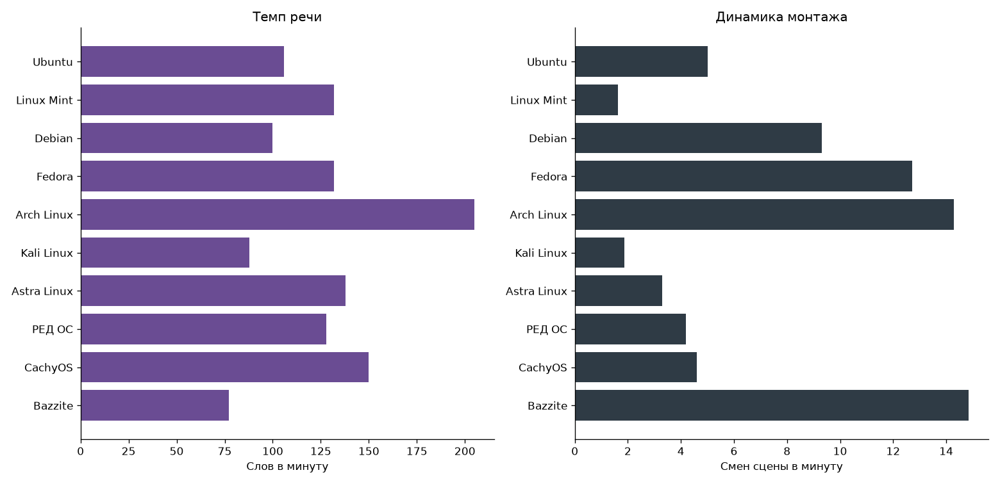

Темп речи и монтаж сильно отличаются:

- самый быстрый рассказ в Arch Linux (205 слов в минуту), самый медленный в Bazzite (77), там много игрового процесса без комментариев;
- самый динамичный монтаж в Bazzite, Arch и Fedora (13-15 смен сцены в минуту), а Linux Mint и Kali почти без монтажа (меньше 2 смен в минуту), это скринкасты одним дублем.

Здесь же видно, что адаптивная выборка кадров работает как задумано: со спокойного Linux Mint взято 30 кадров в минуту, а с динамичного Bazzite 62.

### 8.5. Шкала событий

Интерактивная шкала всех роликов сохраняется в `results/timeline.html`, а для каждого ролика рисуется картинка в `results/timelines/`. Вот два ролика, которые сильнее всего отличаются.

**Arch Linux:**

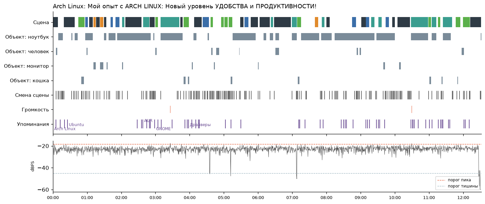

Сцены постоянно меняются между терминалом, браузером и игрой, смены сцены идут очень часто. Громкость ровная почти весь ролик, автор говорит без пауз, поэтому пиков почти нет. Упоминания распределены по всему ролику.

**Bazzite:**

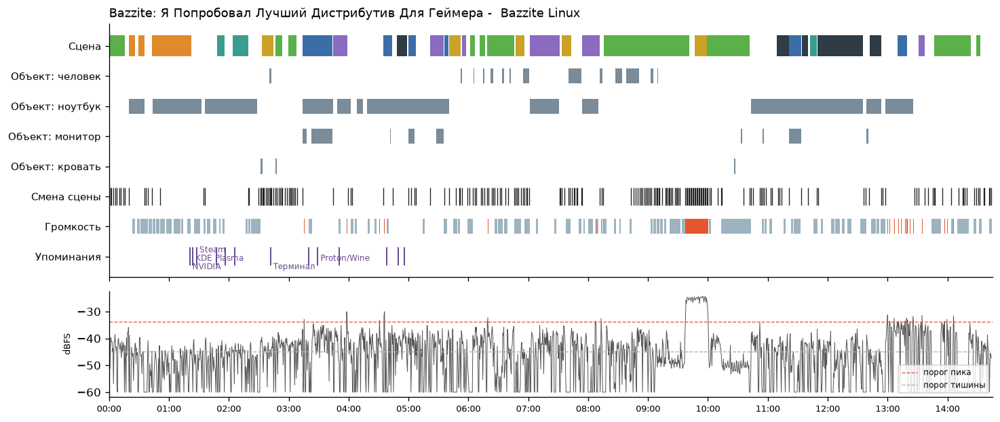

Здесь видно длинные куски игры (зелёные), а в районе 09:30 резкий громкий фрагмент, это игровой звук. Все упоминания программ сосредоточены в первых 5 минутах, где автор рассказывает про систему, дальше в основном игры.

Тут же видна ошибка: тишиной отмечено больше половины ролика. Автор говорит тихо, средняя громкость около -45 dBFS, и мой порог тишины -45 dBFS для этого ролика не подходит. Правильнее считать тишину относительно средней громкости конкретного ролика, а не одним числом для всех.

### 8.6. Темы

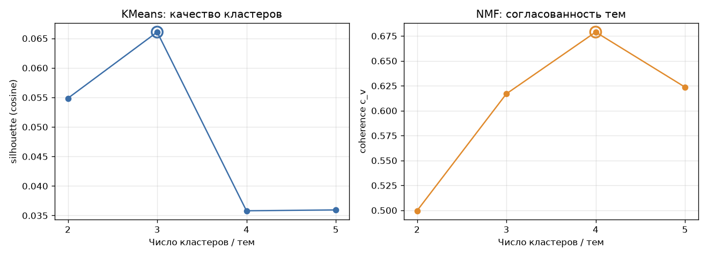

KMeans лучше всего сработал при 3 кластерах, но silhouette всего 0,066, то есть кластеры почти не отделены друг от друга. NMF лучше всего при 4 темах (coherence 0,679).

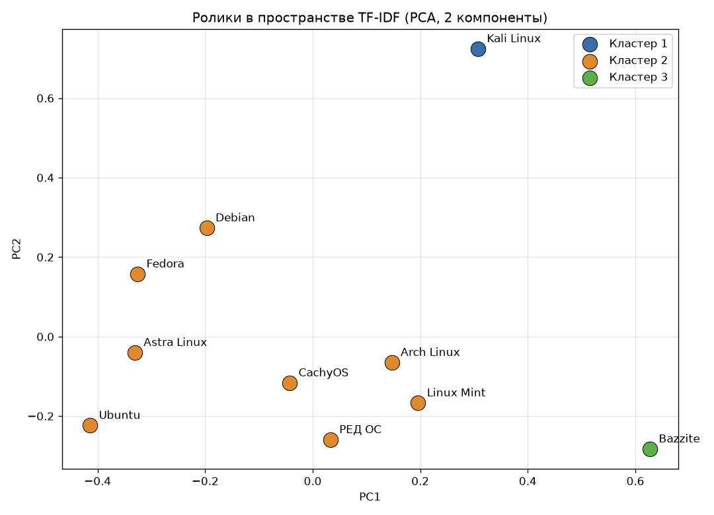

KMeans отделил только два «необычных» ролика: Kali Linux (безопасность) и Bazzite (игры). Остальные 8 обзоров попали в один кластер. Это ожидаемо: все они про установку и настройку, и слова у них похожие.

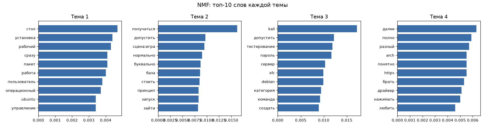

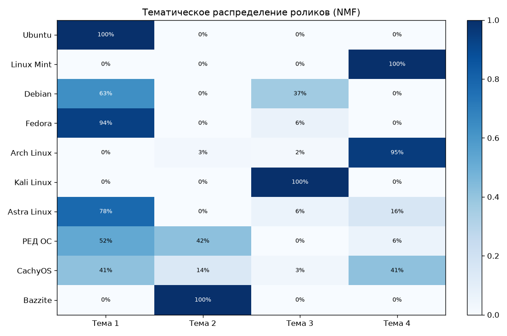

NMF дал более интересное разбиение:

| Тема | Главные слова | Ролики | Как я её назвал |
|---|---|---|---|
| 1 | стол, установка, рабочий, пакет, пользователь | Ubuntu, Fedora, Astra, Debian, РЕД ОС | установка и обзор системы |
| 2 | сцена:игра, запуск, база | Bazzite, часть РЕД ОС и CachyOS | игры |
| 3 | kali, тестирование, пароль, сервер, команда | Kali, треть Debian | безопасность и серверы |
| 4 | arch, драйвер, разный | Arch Linux, Linux Mint, половина CachyOS | опыт использования |

Интересно, что CachyOS наполовину попал в тему Arch Linux, а CachyOS как раз основан на Arch. Debian треть ролика делит с Kali, так как говорит о серверах и стабильности. Визуальное слово «сцена:игра» само попало в топ игровой темы, значит, данные из кадров тоже помогают группировке.

В темах много разговорных слов («получаться», «допустить», «буквально»). Речь в роликах живая, и даже после удаления стоп-слов такие слова остаются. На 10 роликах это неизбежно, для чистых тем нужно больше данных.

### 8.7. Выбор порогов

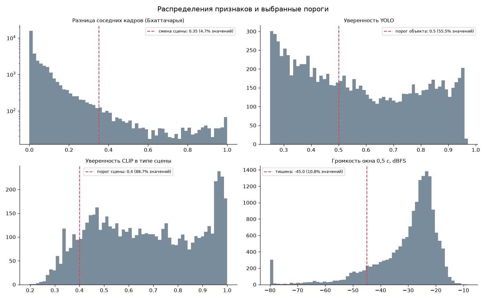

- **Смена сцены 0,35.** Почти все соседние кадры отличаются меньше чем на 0,2 (это один и тот же экран), а дальше идёт длинный хвост. Порог 0,35 стоит там, где основная масса уже закончилась, и отмечает 4,7% сравнений как склейку.
- **YOLO 0,5.** Распределение двугорбое: много слабых срабатываний 0,25-0,4 (по выборке это почти всегда ошибки) и второй горб 0,8-0,95. Порог 0,5 отрезает первый горб и оставляет 55% находок.
- **CLIP 0,4.** Большинство кадров получают уверенность выше 0,4, а пик около 0,95. Ниже 0,4 модель почти угадывает между 8 вариантами, такие кадры я считаю «другое».
- **Тишина -45 dBFS.** Обычная речь в роликах идёт на уровне -35...-20 dBFS, -45 заметно ниже. Для всех роликов, кроме тихого Bazzite, этот порог подходит.

### 8.8. Ручная проверка

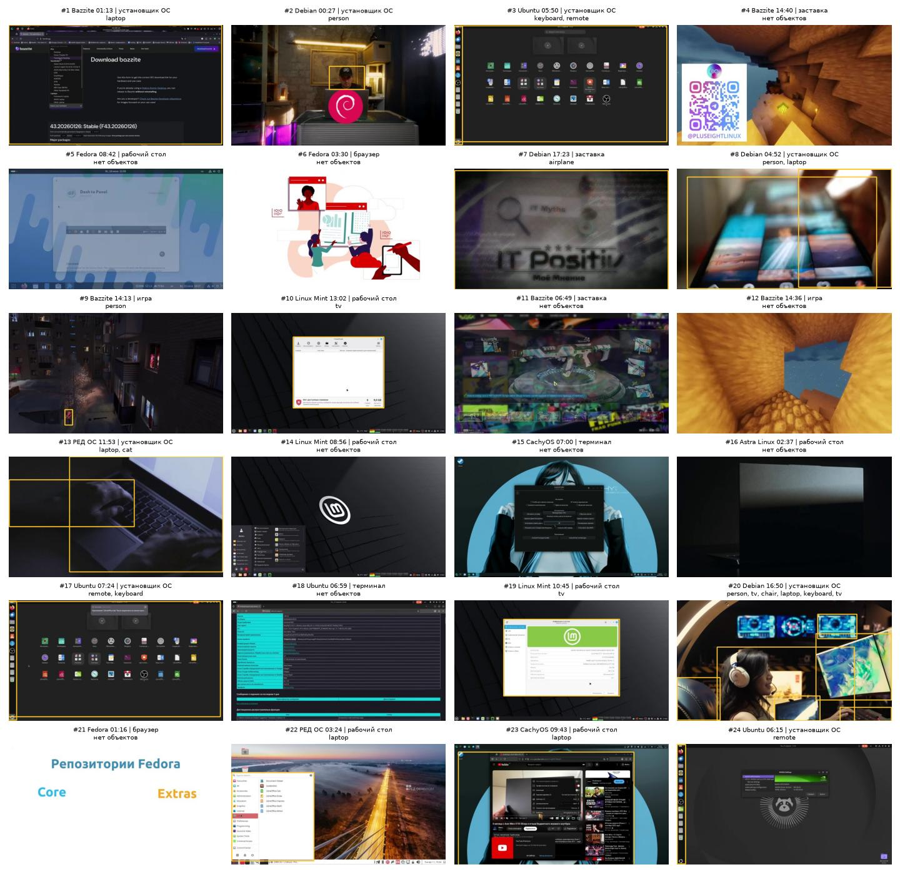

Я сам просмотрел 24 случайных кадра и 15 случайных фрагментов речи.

**YOLO.** На 24 кадрах было 23 рамки, правильных из них 10, то есть примерно 45%. Правильно находятся люди, настоящие ноутбуки, стулья и клавиатуры на живой съёмке (кадры 2, 9, 20). Ошибки почти все на скриншотах: окно программы как ноутбук или монитор (1, 10, 19, 22, 23), иконки как пульт и клавиатура (3, 17, 24), руки на клавиатуре как кошка (13), логотип канала как самолёт (7). На 10 кадрах объектов не нашлось, и в 9 из них это правильно.

**CLIP.** Тип сцены точно угадан на 8 кадрах из 24, ещё на 3 близко (игровое меню вместо игры, браузер на рабочем столе). Получается около 40-45%. Хорошо узнаются рабочий стол, игра и заставка. Главная ошибка: CLIP часто ставит «установщик ОС» любому окну с кнопками и сетке иконок (кадры 1, 3, 17, 24), и даже живой съёмке человека (2, 20). Чтобы это улучшить, можно подобрать подписи точнее или взять модель побольше.

**Whisper.** Из 15 фрагментов 12 распознаны без ошибок. Ошибки в основном в названиях: «Фидор» вместо «Fedora», «СС-h» вместо «SSH», и ещё один фрагмент получился бессвязным («подобный привод канал»). Поэтому в `entities.py` я и делал несколько вариантов написания для каждой сущности. Обычная русская речь распознаётся хорошо.

Таблицы с проверкой лежат в `results/verification/`, в них есть ссылки на каждый момент в ролике.

### 8.9. Интерфейс

Интерфейс запускается командой `python .\app.py`. В нём можно ввести, например, «драйвер nvidia» и получить список моментов из всех роликов, где про это говорят. Клик по строке открывает плеер YouTube прямо с этой секунды, рядом карточка ролика и его шкала событий. Каждый блок на шкале тоже ведёт на свой момент в ролике.

---

## 9. Вывод

Я сделал систему, которая сама разбирает видео на кадры, звук и метаданные, находит объекты, типы сцен, речь и важные моменты, группирует ролики по темам и позволяет найти нужный момент по запросу.

На 10 обзорах дистрибутивов Linux лучше всего сработала речь. Whisper почти без ошибок переводит её в текст, и по транскрипту хорошо видно, о чём ролик: про Debian говорят как об основе других систем, про драйверы и NVIDIA - почти везде, а Windows упоминают так же часто, как Ubuntu.

С картинкой сложнее. YOLO обучена на фотографиях, и на скриншотах путает окна с ноутбуками, а иконки с пультами, правильных рамок около 45%. CLIP лучше понимает, что на экране, и по нему хорошо видно характер ролика: терминал в Kali, игры в Bazzite, автор в кадре в РЕД ОС. Но и у него точность всего около 40%. Для таких роликов нужна модель, обученная именно на скриншотах.

Группировка по темам на 10 роликах получилась слабой по метрикам, но осмысленной: отдельно выделились безопасность (Kali), игры (Bazzite) и опыт с Arch, куда попал и основанный на Arch CachyOS.
