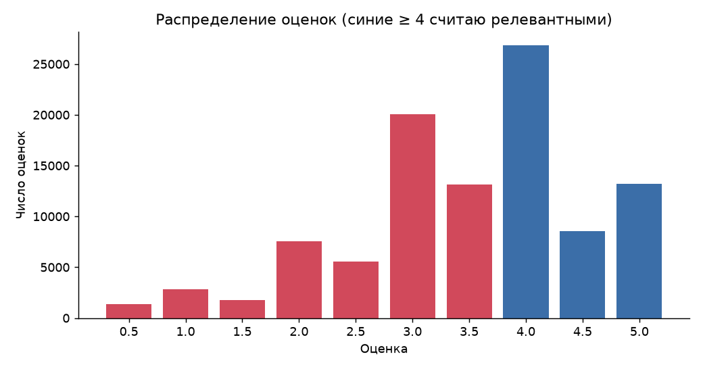
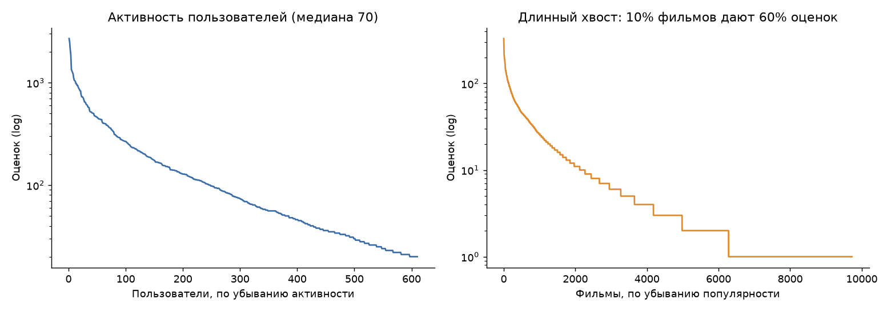
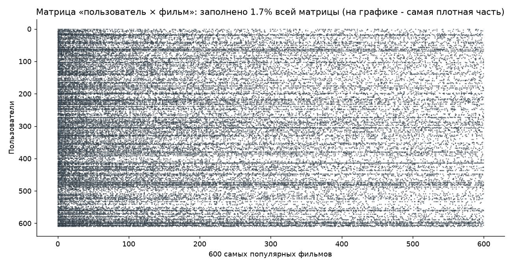
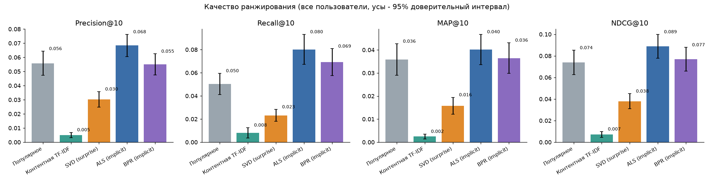
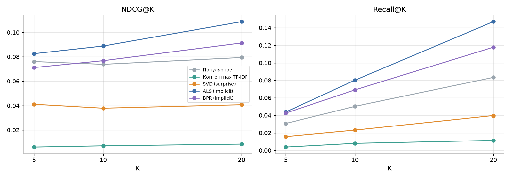
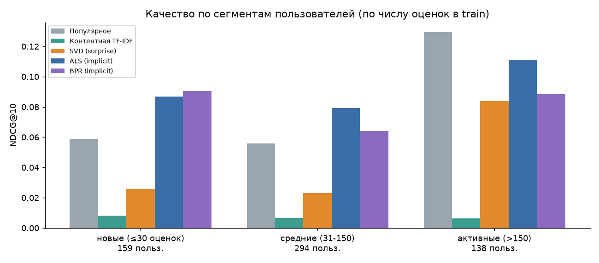
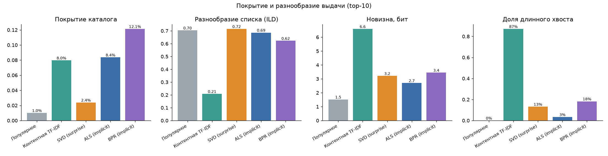
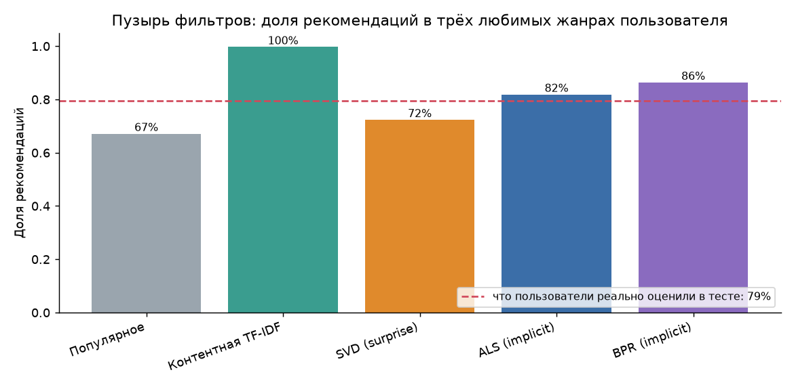

# Лабораторная работа №7 - рекомендательная система для медиакаталога

## 1. Цель работы

Построить и сравнить три подхода к рекомендациям на реальных данных, честно измерить качество и объяснить результаты.

Я взял датасет MovieLens, сделал бейзлайн «самое популярное», контентную модель на TF-IDF, коллаборативную SVD (surprise) и две модели на неявных данных из implicit (ALS и BPR). Для всех моделей посчитал Precision@K, Recall@K, MAP@K, NDCG@K, покрытие каталога, разнообразие выдачи и пузырь фильтров, отдельно по сегментам пользователей.

**Технологии:** Python, pandas, scikit-learn, scikit-surprise, implicit, matplotlib.

---

## 2. Данные

**MovieLens ml-latest-small**: около 100 тысяч оценок от 610 пользователей на 9742 фильма, оценки от 0,5 до 5 звёзд, плюс жанры и теги пользователей.

Почему выбрал его:

- явные оценки нужны для SVD, а превратить их в неявные взаимодействия для ALS и BPR просто: «пользователь посмотрел фильм»;
- у фильмов есть жанры, теги и год, из них можно собрать текстовое описание для TF-IDF;
- 100 тысяч оценок хватает для честного сравнения и при этом всё считается за минуту;
- у каждого пользователя минимум 20 оценок, поэтому временной сплит не оставляет пустых пользователей.

Минус: у фильмов нет настоящих текстовых описаний, только жанры и короткие теги, поэтому контентной модели работать сложнее, чем на Amazon с текстами отзывов.

---

## 3. Структура и запуск

`recsys.py` - CLI, который загружает данные, обучает модели, считает метрики и сохраняет результаты. Загрузка, EDA и сплит лежат в `data.py`, модели - в `models.py`, метрики и графики - в `evaluation.py`. Датасет скачивается сам при первом запуске в папку `data/`. Те же результаты, что в разделе 5, плюс пара графиков по данным собраны в отчёт `Отчет_ЛР7_Данилов.pdf` на 8 страниц.

```powershell
python -m venv .venv
.\.venv\Scripts\Activate.ps1
pip install -r requirements.txt

.\run.ps1                 # все модели, K = 5, 10, 20, EDA, лог в results\run_log.txt
```

Отдельные запуски:

```powershell
python .\recsys.py --dataset movielens --model svd --k 10 --output results
python .\recsys.py --dataset movielens --model als content --k 10 20 --evaluate
```

Без `--evaluate` скрипт только обучает модели и сохраняет рекомендации в `recs.json`. Бейзлайн `popular` добавляется всегда, без него сравнение не имеет смысла.

Что сохраняется в `results/`:

| Файл | Что внутри |
|---|---|
| `metrics.csv` | модель × K × сегмент × метрика, значение и 95% доверительный интервал |
| `beyond_accuracy.csv` | покрытие, разнообразие, новизна, длинный хвост, пузырь фильтров |
| `recs.json` | рекомендации для 20 пользователей с названиями, попаданиями и объяснениями |
| `eda.json`, `eda_*.png` | размер данных, разреженность, распределения |
| `metrics_*.png`, `beyond_accuracy.png`, `filter_bubble.png` | графики результатов |
| `rating_metrics.json` | RMSE и MAE модели SVD на тесте |

---

## 4. Как это работает

**Сплит.** Для каждого пользователя сортирую оценки по времени и последние 20% отправляю в тест. Так модель учится на прошлом и проверяется на будущем, как в реальной системе. Случайный сплит здесь был бы нечестным: модель видела бы, что пользователь смотрел позже. Теги, которые пользователь поставил после начала своего теста, тоже убираю, чтобы они не подсказывали ответ.

**Что считаю попаданием.** Релевантный фильм - тот, которому пользователь в тесте поставил 4 звезды и выше. Каждая модель рекомендует по 20 фильмов, которые пользователь ещё не оценивал в train. Метрики считаю по пользователям, у которых в тесте есть хотя бы один релевантный фильм.

**Бейзлайн «популярное».** Фильмы, которые чаще всего оценивали в train, одинаковые для всех.

**Контентная модель.** Для каждого фильма собираю текст из жанров, тегов пользователей, десятилетия выхода и названия и строю TF-IDF. Профиль пользователя - среднее векторов фильмов, которые он оценил выше своей средней оценки. Рекомендую фильмы с наибольшим косинусным сходством с профилем. Эта модель может рекомендовать фильмы, которых нет в train, потому что у них всё равно есть жанры.

**SVD (surprise).** Раскладываю матрицу оценок на латентные факторы (50 факторов, 20 эпох) и ранжирую фильмы по предсказанной оценке. Дополнительно считаю RMSE и MAE на тесте.

**ALS и BPR (implicit).** Превращаю оценки в неявные взаимодействия «смотрел»: для ALS уверенность растёт с оценкой, для BPR важен только факт просмотра. ALS (64 фактора) восстанавливает матрицу взаимодействий, BPR учится ставить просмотренные фильмы выше непросмотренных.

**Метрики.**

- Precision@K - какая доля из K рекомендаций оказалась релевантной;
- Recall@K - какую долю релевантных фильмов нашли;
- MAP@K - то же, но с учётом того, насколько высоко стоят попадания;
- NDCG@K - качество порядка: попадание на 1 месте ценится больше, чем на 10;
- покрытие каталога - какая доля всех фильмов хоть раз попала в рекомендации;
- разнообразие (ILD) - насколько фильмы внутри одного списка отличаются по жанрам;
- новизна - насколько редкие фильмы рекомендует модель;
- пузырь фильтров - доля рекомендаций в трёх любимых жанрах пользователя, сравниваю с тем, что он реально смотрел в тесте.

**Сегменты.** Делю пользователей по числу оценок в train: новые (до 30), средние (31-150) и активные (больше 150), и считаю метрики отдельно для каждой группы.

---

## 5. Результаты

Все цифры ниже - из одного запуска `run.ps1` (seed 42). Основной K = 10, в скобках у метрик качества - 95% доверительный интервал.

### 5.1 Данные



Средняя оценка 3,5, люди чаще ставят целые звёзды. Оценок 4 и выше почти половина (48%), поэтому релевантных фильмов в тесте много: 9232 из 19 940 оценок.



Медиана - 70 оценок на пользователя, но есть человек с 2698 оценками. 10% фильмов собирают 60% всех оценок, а у трети каталога (3446 фильмов) всего одна оценка. Из-за этого «популярное» - сильный бейзлайн, а коллаборативным моделям почти нечего сказать про хвост.



Матрица «пользователь × фильм» заполнена на 1,7% (разреженность 98,3%). Даже среди 600 самых популярных фильмов много пустых клеток, дальше почти пусто.

Сплит: в train 80 896 оценок, в test 19 940. Ни одна пара «пользователь-фильм» не попала в обе части, и у всех 610 пользователей последняя оценка в train не позже первой оценки в test. 617 релевантных фильмов из теста вообще не встречаются в train - SVD, ALS и BPR угадать их не могут в принципе.

### 5.2 Качество ранжирования

| Модель | Precision@10 | Recall@10 | MAP@10 | NDCG@10 | HitRate@10 |
|---|---|---|---|---|---|
| Популярное (бейзлайн) | 0,056 | 0,050 | 0,036 | 0,074 (±0,011) | 0,31 |
| Контентная TF-IDF | 0,005 | 0,008 | 0,002 | 0,007 (±0,003) | 0,05 |
| SVD (surprise) | 0,030 | 0,023 | 0,016 | 0,038 (±0,007) | 0,22 |
| **ALS (implicit)** | **0,068** | **0,080** | **0,040** | **0,089** (±0,011) | **0,42** |
| BPR (implicit) | 0,055 | 0,069 | 0,036 | 0,077 (±0,011) | 0,36 |



- **ALS - лучшая модель** по всем метрикам. NDCG@10 на 20% выше бейзлайна, Recall@10 на 60% выше (0,080 против 0,050). Хотя бы одно попадание в топ-10 есть у 42% пользователей, у популярного - у 31%. По NDCG интервалы ALS и популярного немного перекрываются, а по recall и hit rate разница уже явная.
- **BPR** по precision и NDCG на уровне популярного, но находит больше релевантных фильмов (Recall 0,069).
- **SVD в два раза хуже популярного**, хотя оценки предсказывает нормально: RMSE 0,889, MAE 0,684. SVD учится угадывать оценку, а не то, что человек посмотрит. Наверх у неё попадают «Лоуренс Аравийский», «Касабланка», «Мост через реку Квай» - фильмы, которым все ставят высокие оценки, но смотрят их немногие. Хорошая RMSE не значит хорошее ранжирование.
- **Контентная модель - худшая.** После того как я убрал теги «из будущего», теги остались только у 302 фильмов из 9742. У остальных описание - это жанры и десятилетие. Комбинаций жанров всего 951, и тысячи фильмов выглядят одинаково (одних «Comedy|Drama» 435). Модель не может их различить и берёт малоизвестные фильмы с подходящим набором жанров: 87% выдачи - длинный хвост. Я пробовал домножать сходство на популярность. NDCG@10 вырос до 0,045, но всё равно остался ниже бейзлайна, а модель по сути превратилась в «популярное», поэтому я оставил чистый вариант.



С ростом K отрыв ALS растёт: Recall@20 - 0,147 против 0,083 у популярного. При K=5 BPR даже чуть хуже популярного по NDCG (0,071 против 0,076), но с K=10 его обгоняет.

### 5.3 Сегменты пользователей



| Сегмент | Пользователей | Релевантных в тесте (медиана) | Популярное | ALS | BPR | SVD |
|---|---|---|---|---|---|---|
| новые (≤30 оценок) | 159 | 3 | 0,059 | 0,087 | **0,091** | 0,026 |
| средние (31-150) | 294 | 8 | 0,056 | **0,079** | 0,064 | 0,023 |
| активные (>150) | 138 | 35 | **0,129** | 0,111 | 0,088 | 0,084 |

(в таблице NDCG@10)

- Для **новых и средних** пользователей ALS и BPR в 1,4-1,5 раза лучше бейзлайна. Персонализация здесь даёт больше всего, и BPR на новичках даже чуть лучше ALS. У новых интервалы широкие (±0,024), потому что пользователей мало, а релевантных фильмов у каждого всего около 3.
- Для **активных** по NDCG лучше всего популярное. У таких людей в тесте десятки релевантных фильмов, и среди них много известных, до которых они просто не дошли раньше. Популярное попадает в них «по площади». При этом хотя бы одно попадание у ALS бывает чаще (hit rate 0,55 против 0,48), просто ниже в списке.
- **SVD** заметно лучше работает на активных (0,084 против 0,023-0,026 у остальных): ей нужно много оценок, чтобы выучить вектор пользователя.

### 5.4 Покрытие и разнообразие



- **Популярное** использует 1% каталога (98 фильмов на всех), один и тот же фильм есть в 67% списков.
- **SVD** немногим лучше: 2,4% каталога, один фильм в 75% списков. По сути это тоже общий топ, только «лучших по оценке».
- **ALS** берёт 8,4% каталога, но почти только из головы: 3% хвоста, новизна 2,7 бита. Часть её точности - умение выбрать нужное среди популярного.
- **BPR** самая широкая из точных моделей: 12,1% каталога, 18% хвоста. При точности на уровне популярного это даёт пользователю гораздо больше разных фильмов.
- **Контентная** по новизне и хвосту рекордсмен (6,6 бита, 87%), но разнообразие внутри списка у неё самое низкое (ILD 0,21): все 10 фильмов с одним набором жанров. У остальных моделей ILD 0,62-0,72.

### 5.5 Пузырь фильтров



Для каждого пользователя беру три самых частых жанра среди фильмов, которые понравились ему в train, и смотрю, какая доля рекомендаций в них попадает. Для сравнения: среди фильмов, которые пользователи реально высоко оценили в тесте, таких 79%. Значит, люди и сами в основном смотрят «свои» жанры.

- Контентная модель - полный пузырь: 100% выдачи в любимых жанрах.
- ALS (82%) и BPR (86%) лишь немного сильнее реального поведения, на 3-7 процентных пунктов.
- Популярное (67%) и SVD (72%) ниже реального уровня, потому что жанры пользователя они не учитывают вообще.

Получается, что сильный пузырь создаёт контентная модель, а коллаборативные модели почти повторяют реальные вкусы. Метрика грубая: в тройку любимых жанров почти у всех входят Drama и Comedy, а это половина каталога. В реальной системе я бы добавил к ALS немного случайных фильмов из нелюбимых жанров или переранжирование по разнообразию (MMR).

### 5.6 Ручной разбор двух пользователей

Полные списки лежат в `results/recs.json`, «+» - попадание в тест.

**Пользователь 451 - новичок, 28 оценок.** В 1996 году высоко оценил «Фарго», «12 обезьян», «Историю игрушек», «Разум и чувства», «Покидая Лас-Вегас». В тесте ему понравились «Беглец», «Молчание ягнят», «Ромео + Джульетта» и MST3K.

- Популярное: «Форрест Гамп», «Побег из Шоушенка», «Криминальное чтиво»… + «Молчание ягнят» на 5 месте.
- BPR: + «Беглец», и весь список - фильмы 1994-1996 годов («Багровый прилив», «Правдивая ложь», «Мистер Холланд»). Модель уловила, что человек смотрит новинки своего времени.
- ALS: попаданий нет, но выдача той же эпохи и с понятными объяснениями: «Джерри Магуайер» - потому что понравился «Разум и чувства», «Первобытный страх» - из-за «Времени убивать».
- SVD: «Лоуренс Аравийский», «Окно во двор», «Хладнокровный Люк» - список великих фильмов, к этому человеку отношения не имеет.
- Контентная: девять романтических комедий 90-х (Bulworth, Singles, Clueless) с объяснением «romance, decade_1990, comedy». По жанрам логично, но фильмы малоизвестные.

**Пользователь 122 - активный, 234 оценки.** Любит трэш-хорроры и чёрные комедии: Planet Terror, «Оно», «Идиократия», «Армагеддец», «Тёмный город». В тесте 53 релевантных фильма, и почти все старые: «Эпидемия», «Охотник на оленей», «Кэрри», «Синий бархат», «Ребёнок Розмари». Похоже, после новых фильмов он начал оценивать классику, и для временного сплита это самый сложный случай.

- BPR: «Убить Билла», «Город грехов», «Драйв», «Донни Дарко», «Район № 9». По вкусу очень точно, но ни одного попадания.
- ALS: «Донни Дарко», «Район № 9», «Петля времени», «Грань будущего» - тоже его жанр, объяснения через «28 дней спустя» и «Интерстеллар».
- Контентная: единственная с попаданием - + «Эпидемия» (sci_fi, action, thriller). Остальное - «Телепорт», «Стелс» и подобные слабые фильмы.
- SVD: «Касабланка», «Китайский квартал», «Доктор Стрейнджлав». По духу это ближе к тому, что он реально смотрел в тесте (старое кино), но точных совпадений нет.

Вывод по разбору: метрики занижают ALS и BPR. Рекомендации у них осмысленные, но попадание засчитывается, только если человек оценил именно этот фильм.

### 5.7 Выводы

1. Лучший подход на этих данных - **ALS на неявных данных**: NDCG@10 0,089 против 0,074 у бейзлайна и Recall@10 на 60% выше. Обучается меньше чем за секунду.
2. **Популярное - сильный бейзлайн** из-за длинного хвоста, а для активных пользователей по NDCG оно даже лучшее. Без него ALS выглядела бы «плохой» (NDCG 0,09), хотя на самом деле она заметно лучше простого топа.
3. **Предсказание оценки и ранжирование - разные задачи.** У SVD приличная RMSE 0,889, но ранжирует она в два раза хуже популярного.
4. **Контентной модели на одних жанрах мало.** Она создаёт полный пузырь фильтров и почти не угадывает. Её место - холодный старт для новых фильмов (это единственная модель, которая рекомендует фильмы без оценок в train, 6% выдачи) или гибрид с ALS.
5. **Компромисс точности и широты:** ALS точнее, BPR шире по каталогу (12% против 8%) и чаще берёт хвост. Если бы я выбирал для продакшена, взял бы ALS и добавил к ней немного выдачи BPR или контентной модели для разнообразия.
